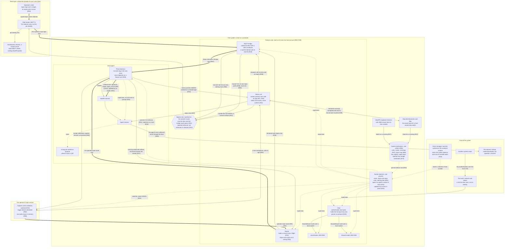

# MIS-0007: The system daemon, MacEff's grouping layer

**Number**: 0007
**Type**: Standards
**Status**: Final-Comment
**Authors**: the operator; drafted by the head maintainer as Secretary
**Secretary**: the head maintainer
**Deliberation**: https://github.com/cversek/MacEff/issues/867
**Created**: 2026-10-28
**Updates**: none
**Supersedes**: none
**Lands-in**: a system daemon in the macf package, with its tests (planned); framework/policies/base/infrastructure/persistent_layer.md, a section on the system daemon (planned); framework/glossary.md (planned)
**Resolution**: none

---

## 1 Summary

A system daemon is one process per system, run by root. It starts each of its units as the account its system declaration names, supervises them, and runs no feature code itself. Around that root process sit named units, each on an account of its own: a router for the event streams that leave an agent, a status unit that reports every unit on the system, a door for connections from other systems, and, where the system belongs to a fleet, a bridge that publishes to the fleet's broker. Units that hold what belongs to the system, or that serve every agent on it, run under the system daemon. Units that belong to one agent stay with that agent's primal daemon (MIS-0002).

Together these make the system daemon MacEff's grouping layer. An agent has its primal daemon, a system has its system daemon, and a fleet may later have units of its own. A service lives at the smallest group that shares it (P01). Data goes up, and every reader weighs it. Inside a system the kernel names each caller; past its edge a key does. The one thing that comes down is the operator's own input: signed, carried only on a route declared for it, and verified by the primal daemon where it acts.

MIS-0004 depends on the system daemon directly, because its mail broker is a system-daemon unit. The operator proposed the system daemon on #850, MIS-0004's deliberation, and on 2026-10-28 moved that its requirements be documented in a separate draft, so mail and the system daemon could be developed in parallel (#850, comment 6477160351). On 2026-10-31 he convened a deliberation on #867 that widened the scope to the grouping layer (P01). This revision carries that deliberation's outcome, as the Secretary's synthesis on #867 proposes, and the two prototypes' results that came before it. This MIS concerns the operator, who installs and declares the system daemon, and every agent on a system that has one.

## 2 Motivation

- **A unit that needs another account has no supervisor.** A primal daemon starts units only as its own account (persistent_layer 10.3, under MIS-0002-R78 (layer_MUST-NOT_widen_permissions)). So a mail broker on its own account needs something that can start a unit as a declared account. Without one shared supervisor, each such service gets a service daemon of its own, which is the sprawl MIS-0002 set out to end (the operator, #850 comment 6471946844). Evidence: the policy, and the positions on #850.
- **Shared resources are duplicated per agent.** A warm embedding model holds 1,273 MB resident, once per agent under MIS-0006's draft, although only each agent's index is private. The subscription's usage reading runs in every agent's hooks, each with its own copy of the credential. Once a fetch failed, every hook on the host retried it on every tool call (#852). Evidence: a measurement (the search service) and an incident.
- **Only a parent can read an exit status.** A primal daemon restarted beside its running session adopts that session. At every planned restart it then reports the session failed, because only a parent reads an exit status (Seat N, #850 comment 6476229730). Evidence: an incident, reported by the seat.
- **A container's start step already does this job, once.** It renders declarations that only root can write, and starts each daemon as its account (persistent_layer 10.1). Nothing keeps doing that after the start (#850 comment 6475537319). Evidence: the deployment.
- **A grouping of agents shares more than a broker.** The status of every unit, the network door, the streams that leave an agent, and shared services all belong to a system rather than to any one agent (P01). Without one place for them, each arrives as its own daemon or its own listener. MacEff already runs three listeners on loopback that any local account can reach (#868). Evidence: the deliberation, and an audit of today's listeners.
- **Seats lose work in ways no status shows.** A session waiting on a prompt read healthy for most of a day, a restart left a seat's notice channel failed while its status read running, and one failing unit woke a seat dozens of times in a night (P21). Evidence: the container seats' reports, relayed.

## 3 Goals and Non-Goals

**Goals**
- One supervisor per system for the units that need an account other than an agent's, or that serve every agent on the system.
- A privileged part as small as it can be: root only starts, stops and accounts for units. Every other duty of the grouping layer is a named unit on an account of its own (P03).
- A placement rule that says where any new unit goes, at the agent, the system or the fleet, so no layer becomes the next sprawl.
- One door for everything that crosses a system's boundary, and a fleet hop on a mature protocol, MQTT 5, that subscribers can use with nothing MacEff-specific (P15).
- The operator's own input as the one thing that flows down: signed, routed only where declared, and verified where it acts.
- One system declaration format for a Linux container, a Linux host and macOS, with each platform's limits stated.

**Non-goals**
- The units' own behavior. Mail is MIS-0004's, and the shared embedding model is MIS-0006's.
- Replacing the primal daemon. Each agent's primal daemon keeps supervising that agent's session and its own units. The system daemon supervises accounts and shared resources, not sessions.
- The fleet's own units. This MIS writes the system's side of the fleet hop. Choosing the broker, deploying it, and its ACL and listeners belong to a fleet MIS when there is a fleet (Q04).
- An agent's own outbound traffic, to GitHub, model downloads or the operator's channel. It doesn't pass through the door (R50).
- The dictation feature the operator described (P08). This MIS lays its groundwork: the operator-input class, its route, its key and its provenance.
- Changing MIS-0002's notice contract. Operator input is its own class, never a notice, and the MIS-0002 amendments the dictation feature will need are named in section 9 for when it is built.

## 4 Guide-Level Explanation

The operator installs the system daemon once per system, as root, with a system declaration that only root can write. The declaration lists units, each with the account it runs as, how it starts, its environment and its restart policy. It also lists the system's routes and every crossing of its boundary, and holds the registry of keys the system trusts. The daemon forks, changes to the unit's account, executes the declared command and reaps it. It does nothing else as root.

In a container, it also parents each seat's primal daemon, so it reads each one's exit status. On a host, a primal daemon belongs to its login's service manager, launchd on macOS or the user's systemd on Linux, so the system daemon watches it instead: it reads its exit status from that manager and reports when it is down, but neither starts nor restarts it. Each system daemon is checked by an outside watch that doesn't run under it.

**The units of the grouping layer.** Each is a process on an account of its own, so a fault in one costs only its own work.
- **The router** forwards the event streams that leave an agent. Each primal daemon pushes to it over a Unix socket, and the kernel names the sender. A route names the event types it carries. The router holds a record only while it is in flight, keeps counters and offsets, and when a route's queue is full it drops and counts rather than slowing the agent. The record stays in the agent's own store.
- **The status unit** reports every unit on the system. Each primal daemon pushes the status of itself and its units; what the root process witnessed itself is reported apart. Every entry carries its age, and an entry past its interval reads "no report since T". Status carries states and counts, never content.
- **The door** is where identity changes from the kernel's to a key's. It authenticates each connection from another system against a key declared for that peer, and forwards each declared route over a local socket to the unit that owns it. It holds only the transport key and parses no protocol, so a flaw in one service's protocol stays in that service.
- **The bridge** connects a system to its fleet. It is an MQTT 5 client that connects out to the fleet's broker, publishes the declared event types and status, and receives the operator's input for this system.

A primal daemon never depends on any of these to run or to record. If the router, the door or the bridge stops, routes stop and nothing else does.

**Status.** What the seats asked status to show (P21) mostly belongs to each primal daemon, which already records a session waiting on a person and a dark channel under MIS-0002; status by push carries those states up (Q08). Where a watched unit's login is absent, status says so rather than calling the unit failed. A unit's failures reach its agent once when they begin and once when they end, never once per restart attempt. A unit that reports it is waiting on a person, such as a service that holds a key and waits for the operator to unlock it, reads as healthy and is not restarted for it. On a login several agents share, the kernel names the login and not the agent, so what is pushed from there is labelled claimed.

**The door and the system's crossings.** "Everything crosses through the door" has to be checkable, so the declaration lists every crossing of the system's boundary: listeners, mounted directories and files, and passed-in sockets. Between a host and its containers, today's crossings are mounted directories (the amail hand-off, a host-owned stop switch) and the Docker socket. MacEff's own loopback listeners are crossings too, since every local account can reach them, until #868 moves them to Unix sockets. Status compares the list with what is bound and mounted, and reports a difference without refusing to start. The door sits behind the host's network: in a container the tailnet belongs to the host, and a tailnet proves which machine connected, not which system or agent (P07). The egress rule lets only the door's and the bridge's accounts reach other systems' doors and the fleet broker, each only its declared peers. The door is not on the path of an agent's own outbound connections and never terminates their TLS. A development server an agent starts on loopback for its own tests is the agent's work, not a MacEff crossing.

**The operator's input.** Three tiers of provenance are possible, and the receiving primal daemon sets the tier from the transport and any signature, never from the text (P11):
- **signed**: an operator key no agent can use, over a target primal daemon, an expiry and a nonce accepted once. Across a system boundary it is the only tier there is.
- **kernel-named**: the peer uid of an account no agent holds, within one host.
- **claimed**: on a login the agents share, where neither of the above holds.

Operator input travels only on a route declared for it. The session sees it labelled with the receiver's verdict, and every unit that transformed it is named beside the original. Each input ends in a receipt to its sender: delivered, expired, refused, or matched to no agent. Input past its expiry is shown as expired, even after a hold while the session was down. It is never typed as keystrokes (MIS-0002-R105 (keystroke_wake_MUST_be_fallback_only)): through the channel, a dictated "yes" can't answer an open dialog.

Dictation is the first case (P08, P10 to P13). A capture unit runs in the operator's login session, because the microphone grant and the hotkeys belong there, and the system daemon watches it. Its declaration names its trigger devices, and nothing else opens the microphone. Raw audio stays in its memory and leaves the system only for a declared transcription service, through the door. On a host with one operator the model runs in the capture unit itself, the grouping rule at its smallest group (P12, P13). It reports a live microphone as a status entry, so a remote operator can see it. Input triggered by a wake phrase never satisfies anything an authorization depends on, because anything with a speaker can say the phrase.

**The fleet hop.** MQTT 5, with the broker at the fleet and every system connecting out to it, so no system listens for the fleet (P15, P16, P17, P19). The bridge holds a client certificate, whose fingerprint goes in the same registry as the agents' keys and rotates the same way. A system is in a fleet only because its own declaration names the broker and pins its certificate. The bridge publishes status retained, each payload carrying the time it was produced and an MQTT 5 message expiry, and never retains event data. Its last will says only that the link was lost; the system's own status, with its age, says how the system is. Each event type maps to one topic under the system's own prefix, and each event carries its id and offset, so a consumer can drop the repeats QoS 1 delivers. On the way down, the bridge passes on nothing flagged retained and nothing from another system's topic, and the receiving primal daemon verifies the signature. A subscriber knows that the broker accepted the bridge's certificate, not that a payload is what the system sent; that is enough for data the reader weighs (Q09).

**How the grouping layer connects.** The diagram is drawn for agents to read as text, so it names every piece and every flow rather than laying them out for the eye. Solid arrows carry data, which every reader weighs. Thick arrows carry the operator's input, the only thing that travels down. Dotted arrows are supervision.

To place a new unit, ask three questions:
- **Whose secret does it hold?** That decides its account.
- **How many agents does it serve?** That decides its supervisor: the agent's primal daemon, the system daemon, or, when systems share it, the fleet.
- **Does it need a login's session, for a privacy grant or the login keychain?** Then it runs in that session, and the system daemon watches it.

The usage reading is an example. It holds a person's credential and serves every agent on that person's login. So it runs once per login, as that login. On macOS it is a LaunchAgent the system daemon watches. Each agent given a login of its own needs its own client credential, which multiplies those readers, so one reader serving other logins through the system daemon's feed keeps the account-wide reading to one (#850, 6481387490). When agents on several systems share one subscription, the reading moves up again, to the fleet: it is the first service that belongs there (P03).

**The system declaration's format** is #856, which both prototypes import; this summary follows it at 9059a177, and the routes, crossings, topic map and registry entries above are what the revision adds to it. A declaration describes one system, so its units share one platform. It has `version`, `system`, one `time_zone`, `stop_timeout_s` and its `units`. Each unit has:
- `name`, `account` and `relationship` (parent or watch), plus `liveness_interval_s`, `after` for the start order, and an `identity_probe` for R12;
- a `platform`: `linux`, with `stop` set to `cgroup` or `subreaper`, or `launchd`, with a `domain` (`system`, or a login's `gui` or `user`) and a `label` unique within its domain;
- on a parented unit only: `command`, `environment` in full, `restart`, `exit_codes`, `stop_grace_s`, a required `memory_limit_mb`, and up to 16 `groups`.

A watched unit carries none of the parented-only keys, since the system daemon neither starts nor stops it, and a parented launchd unit lives in the system domain. On launchd, `groups` names memberships the account already holds, which the loader verifies, because launchd takes a job's groups from the directory. The system daemon sets `TZ` and the unit's marker itself, and a unit can't declare them. A parented unit's exit code is read through the exit table:

| A parented unit exits with | `restart: always` | `on-failure` | `never` |
|---|---|---|---|
| a code in `success` | restarted | stays stopped | stays stopped |
| a code in `no_restart` | stays stopped | stays stopped | stays stopped |
| any other code | a failure, restarted with backoff | a failure, restarted with backoff | a failure, stays down |

Under `on-failure`, a unit that wants a restart has to fail. Under `never`, a unit that stops stays down and is reported, and restarting it is the operator's act, recorded as his: a pre-registered experiment that records a gap as a gap wants exactly that (P21). A watched unit's `restart` is `never`, because its own service manager restarts it (R41).

## 5 Terms

These are the terms the Specification uses beyond the glossary.
- **system**: one host, or one container.
- **system daemon**: the one root-run process per system that starts, stops and accounts for the units its system declaration names, each as its declared account.
- **grouping layer**: the system daemon and its units, seen as one of MacEff's groupings: an agent's primal daemon, a system's system daemon, and a fleet's units.
- **system declaration**: the file, writable only by root, that lists a system daemon's units, with each unit's account, command, environment and restart policy, and the system's routes, crossings and key registry.
- **unit**: a managed unit (glossary), here one of the system daemon's.
- **feature unit**: a unit of the system daemon that runs feature code, such as the router, the status unit, the door, the bridge or the mail broker.
- **root process**: the system daemon's own process, the one that runs as root.
- **feature code**: code that does a unit's work, as opposed to starting, stopping and accounting for units.
- **parent**: the relationship in which the system daemon starts a unit and reads its exit status.
- **watch**: the relationship in which the system daemon observes a unit it did not start, and reports when it is down.
- **session-bound unit**: a unit that needs a login's GUI session, for a privacy grant or the login keychain.
- **restart report**: the notice, after a restart, of which units were carried, which changed, and what was lost.
- **feed**: data the system daemon publishes for primal daemons and hooks to read and weigh.
- **store**: the records an agent's own code writes, its event log and its mailbox.
- **router**: the unit that forwards the event streams that leave an agent, on declared routes.
- **route**: a declared path from a named source to a named destination, with the event types it carries and the ceiling of its queue.
- **status unit**: the unit that receives what each primal daemon pushes about itself and its units, and reports one status per system.
- **door**: the unit that authenticates connections from other systems and forwards each declared route to the unit that owns it, parsing no protocol.
- **bridge**: the unit that connects a system to its fleet broker as an MQTT 5 client.
- **crossing**: any channel across a system's boundary: a listener, a mounted directory or file, or a passed-in socket.
- **fleet**: the systems whose declarations name the same fleet broker.
- **fleet broker**: a fleet's MQTT 5 broker, a unit of the fleet's own.
- **operator input**: content the operator chose for an agent, carried on a route declared for it and verified by the receiving primal daemon; never a notice.
- **capture unit**: a session-bound unit that turns the operator's speech into operator input.
- **provenance tier**: how a receiver knows who sent something: **signed**, by a declared key; **kernel-named**, by the peer credentials of an account no agent holds; or **claimed**, on the sender's word alone.
- **outer manager**: the service manager that starts the system daemon: launchd, systemd, or a container's runtime.
- **stop timeout**: the outer manager's limit on stopping the whole system daemon, such as a container's `docker stop -t` or launchd's `ExitTimeOut`.
- **marker**: the environment value `MACEFF_SD_UNIT`, which the system daemon sets in each unit: the unit's own name for its processes, and for its identity probe. It is not how root finds a unit's processes, since root without `CAP_SYS_PTRACE` can't read another account's environment.
- **unit supervisor**: a process the root process forks for one unit, which runs as the unit's account, starts the unit, and ends every process the unit leaves behind.
- **exit table**: how a unit's exit code is read: a code meaning success, a code meaning do not restart, or any other code, a failure.

## 6 Specification

The Secretary gathered the first requirements from the positions on #850, at the operator's motion of 2026-10-28, and the rest from the deliberation on #867. Section 7 gives each one's reason and source. Section 12 says how each lands.

### 6.1 The root process

- **R01** [MUST · decidable: macf/tests/test_sd_root.py::test_one_per_system] Each system MUST run at most one system daemon, started as root by the system's own service manager. (system_daemon_MUST_be_one_per_system)
- **R02** [MUST · decidable: macf/tests/test_sd_root.py::test_root_only_supervises] The root process MUST only start declared units as their accounts, stop them, and reap or read their exits, and run no feature code. (root_MUST_only_supervise)
- **R03** [MUST · decidable: macf/tests/test_sd_root.py::test_declaration_parsed_unprivileged] The system daemon MUST parse its system declaration in a process without root, and import nothing from any unit's tree. (declaration_MUST_be_parsed_unprivileged)
- **R04** [MUST · decidable: macf/tests/test_sd_root.py::test_unit_files_by_descriptor] When root touches a unit's file, it MUST open it by descriptor without following links, check the owner on that descriptor, and act relative to it. (root_MUST_act_by_descriptor)
- **R05** [MUST · decidable: macf/tests/test_sd_root.py::test_stop_reaches_whole_unit] When the system daemon stops a unit, it MUST end every process the unit started, then verify that none remains. (stop_MUST_reach_the_whole_unit)
- **R23** [MUST · decidable: macf/tests/test_sd_root.py::test_subreaper_supervisor_ends_detached] On Linux without a delegated control group, a unit supervisor running as the unit's account MUST be the subreaper of the unit's tree, and end it. (linux_stop_MUST_use_unit_supervisor)
- **R24** [MUST · decidable: macf/tests/test_sd_platform.py::test_stop_sweeps_unit_account] On macOS, stopping a unit MUST boot out its job, then send TERM, wait its grace, and KILL every remaining process of the unit's account. (macos_stop_MUST_sweep_unit_account)
- **R25** [MUST · decidable: macf/tests/test_sd_declaration.py::test_parented_launchd_accounts_unique] On macOS, each parented unit MUST run as an account that no other unit uses. (macos_parented_unit_MUST_have_own_account)
- **R06** [MUST · decidable: macf/tests/test_sd_root.py::test_declaration_root_written] The system daemon MUST refuse a system declaration that any account other than root can write. (declaration_MUST_be_root_written)
- **R07** [MUST · decidable: macf/tests/test_sd_socket.py::test_status_only] The system daemon's socket MUST answer status only, and accept no instruction from any agent. (socket_MUST_answer_status_only)
- **R32** [MUST NOT · decidable: macf/tests/test_sd_root.py::test_root_opens_no_agent_store] The root process MUST NOT open any agent's socket or store. (root_MUST-NOT_open_agent_stores)
- **R43** [MUST · decidable: macf/tests/test_sd_root.py::test_update_reexecs_in_place] An update of the system daemon MUST re-execute the root process in place, keeping its process ID and its units running. (update_MUST_reexec_in_place)

### 6.2 Units and their placement

- **R08** [MUST · decidable: macf/tests/test_sd_units.py::test_feature_code_not_root] Each unit that runs feature code MUST run as a process under a non-root account, never as a thread of the root process. (feature_code_MUST_run_unprivileged)
- **R09** [MUST · judgment: the head maintainer, at review of each new unit] A unit MUST run as the account whose secret it holds, under the supervisor of the smallest group that shares it: an agent, a system or a fleet. (unit_MUST_be_placed_by_secret_and_scope)
- **R10** [MUST · judgment: the head maintainer, at review of each new unit] Where a unit needs a login's session, it MUST run in that session, and the system daemon watches it instead of parenting it. (session_bound_unit_MUST_be_watched)
- **R11** [MUST · decidable: macf/tests/test_sd_units.py::test_parent_in_container] Where the system is a container, the system daemon MUST parent each agent's primal daemon and read its exit status. (system_daemon_MUST_parent_where_it_can)
- **R40** [MUST · decidable: macf/tests/test_sd_units.py::test_host_pd_watched] On a host, the system daemon MUST watch each primal daemon, reading its exit status from the service manager that parents it. (host_pd_MUST_be_watched)
- **R41** [MUST NOT · decidable: macf/tests/test_sd_units.py::test_watched_unit_not_restarted] The system daemon MUST NOT restart a unit it watches, since that unit's own service manager restarts it. (watched_unit_MUST-NOT_be_restarted_by_system_daemon)
- **R12** [MUST · decidable: macf/tests/test_sd_units.py::test_declared_environment_and_identity] Each unit MUST start with only its declared environment, checked under `env -i`, together with the identity it presents to outside services. (unit_environment_MUST_be_declared_in_full)
- **R46** [SHOULD · decidable: macf/tests/test_sd_units.py::test_declared_needs_refused_by_name] A unit SHOULD declare the commands and variables it needs, so a start that lacks one is refused by name. (unit_SHOULD_declare_its_needs)
- **R13** [MUST · decidable: macf/tests/test_sd_units.py::test_one_time_zone] The system daemon MUST declare one time zone for all its units, and state it in every restart report. (system_daemon_MUST_declare_one_time_zone)
- **R14** [MUST · decidable: macf/tests/test_sd_units.py::test_code_version_recorded] When a unit starts, the system daemon MUST record the code version it started from, and report a unit that runs older code. (unit_code_version_MUST_be_recorded)
- **R15** [MUST · decidable: macf/tests/test_sd_units.py::test_restart_report_in_agent_store] After a restart, the report of what was carried, changed and lost MUST be written into the agent's own store, by the agent's account. (restart_report_MUST_reach_agent_store)
- **R45** [MUST · decidable: macf/tests/test_sd_units.py::test_failure_notifies_once_per_stretch] A unit's failures MUST reach its agent once when they begin and once when they end, never once per restart attempt. (unit_failure_MUST_notify_once_per_stretch)
- **R44** [MUST NOT · decidable: macf/tests/test_sd_units.py::test_waiting_unit_not_restarted] A unit that reports it is waiting on a person MUST NOT be restarted for waiting, and reads as healthy. (waiting_unit_MUST-NOT_be_restarted)
- **R16** [MUST · decidable: macf/tests/test_sd_units.py::test_agent_controls_own_units] An agent MUST be able to start, stop, read the status of, and read the logs of the units under its primal daemon, without root or a prompt. (agent_MUST_control_its_own_units)
- **R39** [MUST NOT · decidable: macf/tests/test_sd_units.py::test_pd_runs_without_feature_units] A primal daemon MUST NOT depend on the system daemon's feature units, such as the router, the door or the status unit, to run or record. (pd_MUST-NOT_depend_on_feature_units)
- **R21** [MUST · decidable: macf/tests/test_sd_units.py::test_parented_pd_speaks_by_exit_status] A parented primal daemon MUST tell its parent what it wants only by its exit status, read through the declared exit table. (parented_pd_MUST_speak_by_exit_status)
- **R17** [MUST · judgment: the head maintainer, at review of each feed] Data MUST flow from the system daemon down to primal daemons and hooks as feeds the reader weighs, never as instructions. (feeds_MUST_flow_down_never_instructions)

### 6.3 Status and the outside watch

- **R18** [MUST · decidable: macf/tests/test_sd_watch.py::test_watch_outside_system_daemon] Each system daemon MUST be checked by an outside watch that the service manager runs, never by a unit of that system daemon. (system_daemon_MUST_have_outside_watch)
- **R27** [MUST · decidable: macf/tests/test_sd_status.py::test_status_pushed_to_unprivileged_unit] The status of each primal daemon and its units MUST be pushed by that primal daemon to a unit without root, and reported apart from what the root process observed. (agent_status_MUST_be_received_unprivileged)
- **R30** [MUST · decidable: macf/tests/test_sd_status.py::test_entry_shows_its_age] Each status entry MUST carry the time it arrived, and once its declared interval passes, read as "no report since T", never as its last report. (status_MUST_show_report_age)
- **R31** [MUST · decidable: macf/tests/test_sd_status.py::test_status_carries_no_content] Status MUST carry states, codes, versions, ages and counts, never a unit's content, keys or logs. (status_MUST_carry_no_content)
- **R33** [MUST · decidable: macf/tests/test_sd_status.py::test_shared_login_source_claimed] On a login several agents share, a pushed stream or status MUST be labelled claimed, since the kernel names the login and not the agent. (shared_login_source_MUST_be_labelled_claimed)
- **R42** [MUST · decidable: macf/tests/test_sd_status.py::test_absent_login_reads_absent] Where a watched unit's login is absent, status MUST say the login is absent, not that the unit failed. (absent_login_MUST_read_as_absent)
- **R22** [MUST · decidable: macf/tests/test_sd_socket.py::test_status_reports_egress_rule] The system daemon's status MUST report the egress rule as enforced, not enforced or unknown, from a probe the rule refuses and a control it allows. (egress_rule_MUST_be_reported_by_status)

### 6.4 Platforms and the outer manager

- **R19** [MUST · decidable: macf/tests/test_sd_platform.py::test_reload_waits_for_bootout] On macOS, a reload MUST wait until launchd reports the booted-out job gone before it bootstraps the job again. (reload_MUST_wait_for_bootout)
- **R20** [MUST · decidable: macf/tests/test_sd_declaration.py::test_the_longest_stop_chain_must_fit_inside_the_stop_timeout] The longest chain of unit stop graces, in reverse start order, MUST fit inside the stop timeout the system declaration states. (container_stop_timeout_MUST_exceed_unit_grace)
- **R26** [MUST · decidable: macf/tests/test_sd_platform.py::test_outer_stop_timeout_matches_declaration] Before the system daemon starts, the install or start step MUST set the outer manager's stop timeout from the declaration, or refuse to start where they differ. (outer_stop_timeout_MUST_match_declaration)
- **R28** [MUST · decidable: macf/tests/test_sd_declaration.py::test_macos_door_in_system_domain] On macOS, a door or bridge unit MUST run in the system domain, never in a per-user domain. (macos_door_MUST_run_in_system_domain)

### 6.5 Routes

- **R34** [MUST · decidable: macf/tests/test_sd_router.py::test_router_keeps_no_record] The router MUST hold a forwarded record only while it is in flight, keeping nothing of it afterward but counters and offsets. (router_MUST_keep_no_record)
- **R35** [MUST · decidable: macf/tests/test_sd_router.py::test_full_route_drops_and_counts] When a route's queue reaches its declared ceiling, the router MUST drop and count records, and never slow the primal daemon that sent them. (route_MUST_drop_and_count_at_its_ceiling)
- **R36** [MUST · decidable: macf/tests/test_sd_router.py::test_route_carries_declared_types_only] Each route MUST name the event types it carries, and the router forwards no other type on it. (route_MUST_name_its_event_types)
- **R37** [MUST · decidable: macf/tests/test_sd_router.py::test_pd_resumes_from_delivered_offset] A primal daemon MUST resume each route from the offset the router last delivered, read as a feed it weighs. (pd_MUST_resume_routes_from_delivered_offset)
- **R38** [MUST · decidable: macf/tests/test_sd_router.py::test_reconnect_is_jittered] After the router restarts, each primal daemon MUST reconnect after a jittered backoff, so they don't all reconnect at once. (reconnect_MUST_be_jittered)
- **R64** [MUST · decidable: macf/tests/test_sd_router.py::test_watched_unit_admitted_as_source] The router MUST admit a watched unit as a route's declared source, by its peer uid, as it admits a parented one. (watched_unit_MUST_be_admitted_as_route_source)

### 6.6 The door and the system's crossings

- **R47** [MUST · decidable: macf/tests/test_sd_declaration.py::test_crossings_declared] The system declaration MUST list every crossing of the system's boundary: listeners, mounted directories and files, and passed-in sockets. (crossings_MUST_be_declared)
- **R48** [MUST · decidable: macf/tests/test_sd_status.py::test_status_compares_crossings] Status MUST compare the declared crossings with what the system has bound and mounted, and report each difference without refusing to start. (status_MUST_compare_crossings)
- **R49** [MUST · decidable: macf/tests/test_sd_door.py::test_door_authenticates_and_parses_nothing] The door MUST authenticate each connection against a key declared for its peer, hold only the transport key, and parse no protocol. (door_MUST_parse_no_protocol)
- **R50** [MUST NOT · judgment: the head maintainer, at review of each route through the door] The door MUST NOT carry or terminate an agent's own outbound connections, which stay the agent's. (door_MUST-NOT_carry_agents_own_traffic)
- **R51** [MUST · decidable: macf/tests/test_sd_door.py::test_egress_admits_door_and_bridge_only] The egress rule MUST let only the door's and the bridge's accounts reach other systems' doors and the fleet broker, each only its declared peers. (peer_egress_MUST_match_door_and_bridge_accounts)

### 6.7 The operator's input

- **R29** [MUST · decidable: macf/tests/test_sd_operator_input.py::test_input_routed_and_verified_at_receiver] Operator input MUST travel only on a route declared for it, with provenance set by its receiving primal daemon from the transport and any signature, never its text. (operator_input_MUST_be_routed_and_verified_at_receiver)
- **R52** [MUST · decidable: macf/tests/test_sd_operator_input.py::test_label_is_receivers_verdict] Operator input MUST reach a session labelled by its receiving primal daemon's verdict, never by a field the input carries. (operator_input_label_MUST_be_receivers_verdict)
- **R53** [MUST · judgment: the head maintainer, at review of each operator key's custody] The operator's private key MUST be held under an account no agent runs as, in hardware, or under an access control bound to the dictation unit's code signature. (operator_key_MUST_be_out_of_agents_reach)
- **R54** [MUST · decidable: macf/tests/test_sd_operator_input.py::test_transformation_keeps_original] A transformation of verified operator input MUST keep the verified original and name each unit that changed it. (transformed_operator_input_MUST_keep_original)
- **R55** [MUST · decidable: macf/tests/test_sd_operator_input.py::test_signature_covers_target_expiry_nonce] An operator signature MUST cover the input's target primal daemon, an expiry and a nonce, and the receiver checks all three. (signed_input_MUST_cover_target_expiry_and_nonce)
- **R56** [MUST · decidable: macf/tests/test_sd_operator_input.py::test_nonce_record_survives_restart] The receiving primal daemon's record of accepted nonces MUST survive its restart until each nonce's expiry passes. (nonce_record_MUST_survive_restart)
- **R57** [MUST · decidable: macf/tests/test_sd_operator_input.py::test_expiry_compared_with_clock_allowance] An expiry MUST be compared as an instant, with a declared allowance for clock difference between signer and receiver. (expiry_MUST_be_compared_as_an_instant)
- **R58** [MUST NOT · decidable: macf/tests/test_sd_operator_input.py::test_wake_phrase_never_authorizes] Input triggered by a wake phrase MUST NOT satisfy anything an authorization depends on. (wake_phrase_input_MUST-NOT_authorize)
- **R59** [MUST · decidable: macf/tests/test_sd_operator_input.py::test_raw_audio_stays_in_memory] Raw audio MUST stay in the capture unit's memory, never written to disk, and leave its system only for a declared transcription service, through a door. (raw_audio_MUST_stay_in_capture_memory)
- **R60** [MUST · decidable: macf/tests/test_sd_operator_input.py::test_input_ends_in_receipt] Each operator input MUST end in a receipt to its sender: delivered, expired, refused, or matched to no agent. (operator_input_MUST_end_in_a_receipt)
- **R61** [MUST · decidable: macf/tests/test_sd_operator_input.py::test_expired_input_shown_expired] Operator input past its expiry MUST be shown as expired or not delivered, even after a hold while its session was down. (expired_input_MUST_be_shown_expired)
- **R62** [MUST · decidable: macf/tests/test_sd_declaration.py::test_capture_unit_names_trigger_devices] A capture unit's declaration MUST name its trigger devices, and nothing else opens its microphone. (trigger_devices_MUST_be_declared)
- **R63** [MUST · decidable: macf/tests/test_sd_status.py::test_live_microphone_reported] A capture unit MUST report a live microphone as a status entry, with its age. (live_microphone_MUST_be_a_status_entry)

### 6.8 The fleet hop

- **R65** [MUST · decidable: macf/tests/test_sd_bridge.py::test_retained_status_carries_time_and_expiry] The bridge MUST publish status retained only with the time it was produced and an MQTT 5 message expiry, and retain no event data. (fleet_status_MUST_carry_its_time_and_expire)
- **R66** [MUST · decidable: macf/tests/test_sd_bridge.py::test_last_will_reports_link_only] The bridge's last will MUST report only that its link was lost, never the state of its system. (last_will_MUST_report_the_link_only)
- **R67** [MUST NOT · decidable: macf/tests/test_sd_bridge.py::test_retained_or_foreign_input_dropped] The bridge MUST NOT pass on input flagged retained, or input from any topic but its own system's. (down_path_MUST-NOT_carry_retained_input)
- **R68** [MUST · decidable: macf/tests/test_sd_declaration.py::test_event_types_map_to_own_topics] The system declaration MUST map each event type the bridge publishes to one topic under the system's own prefix. (fleet_topics_MUST_be_declared)
- **R69** [MUST · decidable: macf/tests/test_sd_bridge.py::test_published_events_carry_ids] Each event the bridge publishes MUST carry its event id and offset, so a consumer can drop the repeats QoS 1 delivers. (fleet_events_MUST_carry_event_id)
- **R70** [MUST · decidable: macf/tests/test_sd_declaration.py::test_bridge_certificate_in_registry] Each bridge's certificate fingerprint MUST be declared in the operator's registry with the agents' keys, and rotated as they are. (bridge_certificate_MUST_be_in_the_key_registry)
- **R71** [MUST · decidable: macf/tests/test_sd_declaration.py::test_fleet_joined_by_own_declaration] A system MUST join a fleet only by its own declaration naming the fleet broker and pinning its certificate. (fleet_membership_MUST_be_declared_by_member)

## 7 Rationale and Rejected Alternatives

Each requirement's reason, with its source. Numbers like 6471946844 are comments on #850; P numbers are the positions on #867 (section 14).
- **R01**: one supervisor per system ends the service daemon per service (the operator, 6471946844). The service manager starts it, so the operating system restarts it.
- **R02**: a thread of a root process runs with root's privilege, so feature code can't live there (the container-management maintainer, 6475537319). On Linux the root process forks, changes account, executes and reaps. On macOS launchd is every job's parent, so its verbs there are rendering a unit's plist by descriptor (R04), `bootstrap`, `bootout`, `kickstart`, and reading a job's state (6481387490). Seat M asked that root's job be a closed list, and the container-management maintainer asked that the list go into this MIS verbatim (6476229281, 6476259000). Units that share one account and one trust context can still share a process as threads, as long as that process isn't root's (6472809029, 6475537319). That keeps the operator's performance option. On #867 every participant kept the list closed: status, routing, the door and shared services are units, not verbs of root (P02, P03, P05). A seat asked that a root-run supervisor stay small enough to read in review (P21).
- **R03**: a root-run step once imported from an environment that a service account could rewrite, which made that account's code run as root (Seat M, 6476229281).
- **R04**: a root delete once checked ownership by name, then acted by name, and a symlink swapped in between the two redirected it. The rule ("check the ancestors") was followed both times; what was missing was binding the check to the act (Seat M, 6476229281).
- **R05**: a process-group kill misses whatever detached (Seat M). The previous revision had root find a unit's detached workers by the marker in their environment. The container prototype showed that can't work: Docker's default capabilities leave root without `CAP_SYS_PTRACE`, so reading another account's `/proc/<pid>/environ` failed for root while the unit's own account read it, and every marker sweep came back empty while two detached workers survived (6510997994). launchd fared no better: `launchctl bootout` returned success, but a child that started its own session and ignored TERM and HUP kept running, re-parented to launchd, and a plain TERM sweep missed it too (6538604020). So R05 now states the outcome, and R23 and R24 how each platform reaches it. Where a control group is delegated, ending it is still the stop. The container-management maintainer proposed this as one sentence (6510997994); the Secretary split it into R05, R23 and R24 for the language standard, and added R24 from the macOS report. Both held on #867 as drafted (P02). The seats showed what R05 costs a job an agent starts on purpose to outlive its session; R05 is right about a unit's own processes, and where such a job lives is Q07.
- **R23**: the root process forks a unit supervisor, which becomes the unit's account and sets itself as the subreaper of the unit's tree (`PR_SET_CHILD_SUBREAPER` needs no capability). Every process the unit leaves behind is reparented to it, whatever session it moved to, whatever signals it ignores and whatever environment it cleared. It finds them through `/proc/<pid>/stat`, which anyone can read, sends TERM, and kills what is left after the unit's grace. In the prototype nothing was left. It also keeps root narrower: root signals one supervisor and reads its exit, and never inspects a unit's processes. Granting `CAP_SYS_PTRACE` so root could read markers would let it read and trace every process in the container, against R02 (6510997994).
- **R24**: macOS has no subreaper, so the unit's account is the boundary of the sweep: TERM, a grace period, KILL across the account, then verify (6538604020). The host-side maintainer had asked whether a per-unit supervisor would be needed on macOS as well (6515533280); the sweep across the account answers the same need. It stays as the backstop if the Linux shape comes to macOS, because a child that calls `setsid` still escapes the parent's tree there (P07; Q06).
- **R25**: a sweep across an account ends everything that account runs, so on macOS the account has to belong to the one unit. The host-side maintainer drew this consequence ("one more reason for one account per unit: the account is the sweep's boundary", 6538604020).
- **R06**: the declaration is what keeps a unit's account and command out of an agent's reach (persistent_layer 10.1). On macOS that is a system-domain plist only root can write (6468749316). It now also holds the routes, the crossings and the key registry, so no agent can widen its own grants (P02, P03; MIS-0002-R78 (layer_MUST-NOT_widen_permissions)).
- **R07**: this is the system-level form of MIS-0002-R78 (layer_MUST-NOT_widen_permissions). An agent reads the system daemon's state but never steers it (6472809029). Both prototypes held it: a seat's account sending `stop broker` got status, and the broker kept running (6510997994); on macOS every verb from another account got "status, verb ignored" (6538604020). The socket lives in the runtime directory, not beside the root-owned declaration, where the first macOS install put it and the unit couldn't bind it (6538604020). It stood on #867 (P02).
- **R08**: same reason as R02 (6475537319). It is what makes every new duty of the grouping layer a unit: "So I'd write the system daemon as a root process plus named units, and give each duty its unit" (P03).
- **R09**: whose secret a unit holds decides its account, and how many agents it serves decides its supervisor (6475537319). Asked as one question, the usage reading had no home (6476909402). On #867 the operator's "a service lives at the smallest group that shares it" (P01) became a rule every layer obeys, so a new layer has to justify itself by a service its members share (P05, agreed in P07). The sentence now names the three groups. One subscription shared by systems is the first service that belongs to the fleet (P03).
- **R10**: on macOS, privacy grants attach to the responsible process and the login session (persistent_layer 3.1, 3.2), so a primal daemon stays a LaunchAgent (6472809029, 6475350267). launchd holds a job's exit status for any watcher, so on macOS watching versus parenting comes down to who may start and stop the unit, not who can read its status (6481387490). The host-side maintainer found that a GUI-domain LaunchAgent and its descendants can read the login keychain (6476909402). Whether a system-domain job with `UserName` can read it is untested (Q02). The capture unit for dictation is session-bound for the same reason: the microphone grant and the hotkeys belong to the operator's session (P10, P11, P12).
- **R11**: an adopter can't read a unit's exit status, so every planned restart reported the session failed (Seat N, 6476229730). In a container no GUI session binds a primal daemon, so the system daemon can parent it there (6475537319). Parenting inside the container also retires an interim host tool that restarts the containers' agents whenever Docker reports a container started, an instruction flowing down through a root-equivalent channel (P02). Every participant on #867 agreed to parent in containers (P02, P03, P04). It lands only once Q07 says what keeps running when a parented primal daemon stops or restarts.
- **R40**: on a Linux host the container-management maintainer's own primal daemon is a unit of the login's user service manager, with lingering on and a restart policy of always; that manager records its exit code and status, so the problem behind R11, that only a parent reads an exit status, doesn't arise (P02). Moving it out would break what binds it there: its runtime directory, its user bus and its session's tmux (P02). On macOS launchd holds the status (P03). So hosts watch, Linux included (P04).
- **R41**: two restarters on one job is the race R19 exists for, and `kickstart -k` reruns the definition launchd has cached, which on the host-side maintainer's machine ran the old program after the plist was rewritten (P03). Updating stays the agent's own path: write the plist, boot the job out, wait until the label is gone, then bootstrap (P03). It answers Q01.
- **R12**: units that moved onto declarations lost a timezone and an agent name, and read healthy (#836). After one move, a PATH order made a tool act under a person's login (Seat N). A client running without `USER` filed its credential under a second keychain item (#853). Every variable looked fine except the identity the unit presented, so the check compares that identity too (6476909402). Four of five container seats lost something from the login when they moved onto a daemon: a time zone, a toolchain, a `PATH` order that decided which identity a tool acted as (P21; #905 fixes the last for the default session).
- **R46**: R12's check under `env -i` tests that nothing is inherited, not that what a unit needs is there. A unit that states the commands and variables it needs lets the start refuse a gap by name, rather than the gap being found later by its symptom (a seat, P21).
- **R13**: one restart moved a seat's time zone, and its scheduled wakes fired at the same clock numbers in the new zone (Seat L, 6476228404). A container's clock and its configured zone can disagree (Seat M). The same disagreement between a signer and a receiver is why R57 declares a clock allowance (P07).
- **R14**: a worker without reload served stale code after an update until someone restarted it by hand. A supervisor can't know when a unit needs restarting for new code, so it records and reports, and doesn't guess (Seat L, 6476228404). After a re-exec in place (R43) it is how the operator sees which units still run older code (P02).
- **R15**: the restart report is the most useful notice a seat gets, and it stays the seat's, written by the seat's account (Seat L, 6476228404).
- **R45**: a failing unit woke one seat dozens of times in a night, each wake re-reading a large cached context, and that seat counts this as the most valuable thing a supervisor could fix (P21). A record of each attempt can still be kept; what reaches the agent is the start of the failure and its end.
- **R44**: a service that holds a key and starts locked, waiting for the operator, has to count as healthy in that state, because a restart loop would drop an unlocked key (P21). MIS-0002 already names the state, waiting on a person (MIS-0002-R21 (pd_MUST_report_waiting_on_person)). The supervisor never holds or relays the passphrase: R02 keeps root to its verbs, and R31 keeps keys out of status.
- **R16**: long-lived services survive restarts under a supervisor, but only if the seat keeps control of its own (Seat K, 6476228830). It covers the units under the agent's primal daemon. A primal daemon controlling itself through the system daemon would be instructing it, which R07 forbids (6479561476). A seat asked that this need no prompt that hangs when nobody is watching (P21).
- **R39**: concentrating the network and the routes in one daemon makes it a single point of failure, so it fails local: each primal daemon keeps running and keeps its own log, and only cross-agent and network routes stop (P05). "The router must never be in an agent's own path. A primal daemon hands off and moves on" (P03). The container-management maintainer worded it so it doesn't contradict R11: in a container a primal daemon depends on the root process only to be started and reaped, and on none of the feature units (P07).
- **R21**: a parented primal daemon that asked through the socket would be instructing the system daemon, which R07 forbids, so its exit status is its one channel up (6479561476). The exit table is the primal daemon's own, read the way its core reads it (#856).
- **R17**: a fleet server, if it comes, aggregates the system daemons' reports, and each hop carries data the reader weighs (the host-side maintainer, 6475350267). Mode changes still come from the operator directly, as `public_voice` 2.5 says of relayed words. The one exception is the operator's own input, which section 6.7 governs. The seats who addressed this agreed, and one asked that a relayed request keep showing whose word it was (P21).
- **R18**: a watch that runs inside the thing it watches dies with it. Once the system daemon hosts the broker and the model, its failure takes them all down at once (6475537319). This extends MIS-0002-R74 (pd_MUST_have_outside_watch) to the new locus.
- **R27**: root reading an agent's status would be reading input an agent wrote; that is Seat M's R03 incident with a socket in place of a file (P03). A status unit pulling it would need a grant into each agent's 0700 runtime directory, and a push needs none, since the receiver takes the source from the peer credentials (P04). The container-management maintainer conceded push (P07), and the head maintainer withdrew pull (P06). Two sources stay apart, what the root process witnessed and what the agent says, each with its age (P03, P07). The host-side maintainer proposed it with a second sentence; the Secretary trimmed it to 30 words and made the second sentence R32.
- **R32**: "The root process MUST NOT open any agent's socket or store" (P03). Rendering a declaration root writes is not opening an agent's store; R04 governs the files root touches.
- **R30**: "A roll-up that serves a stale entry as current is worse than a gap, because a gap is what a reader notices" (P02). The container-management maintainer asked that staleness be a requirement and not a habit (P07). The egress probe's last run carries its time like any other entry, so a probe that stopped can't leave "enforced" standing (P07).
- **R31**: "Status, not content" (P02): liveness, exit codes, code versions and restart counts go up, logs stay the agent's (R16) and the restart report stays in the agent's store (R15). The seats agreed provided status never touches a key or a request's contents: "Status yes, contents no" (P21).
- **R33**: "The kernel names each source" holds only where each agent has a uid of its own (P04). On a macOS host and on the container-management maintainer's own Linux host, agents share the operator's login, so the peer credentials name the login (P07). Until agents have logins of their own (MIS-0004-R05 (reachable_agent_MUST_have_its_own_login)), what they push is claimed, as MIS-0004-R46 (shared_login_attestation_MUST_be_labelled) labels signatures (P03, P06).
- **R42**: when the operator logs out, the session's routes go quiet, and status says the login is absent, not that the routes failed (P03). With nobody logged in there is no domain to restart in (Q01).
- **R22**: loading a pf or iptables rule needs root, which R02 keeps from the root process. So the operator's install step loads it and makes it survive a reboot, as a container's start step does today (6481387490, 6481618179). Q05 asked who reads whether it is loaded. A root verb comparing the loaded rule's digest was proposed (P03) and withdrawn (P04): on macOS `pfctl -d` disables pf and leaves the anchor loaded, so a digest can match while nothing is enforced. The rule is read by its effect instead: an unprivileged probe tries a connection the rule forbids and must be refused, while the door's account reaches a declared peer as the control; without the control, a network outage reads as a working rule (P02). REJECT on Linux and `block return` on macOS give the probe an immediate refusal (P04). The three readings are enforced, not enforced and unknown (P04, P07). The probe runs at each status interval and right after the system daemon starts (P07).
- **R19**: `launchctl bootout` returns before the job has exited, so a bootstrap straight after it fails with error 5 (#841, 6468749316).
- **R20**: docker's default stop timeout is 10 s, shorter than a session unit's 30 s stop grace (persistent_layer 6.2), so `docker stop` kills units mid-grace, and does so today (6479561476). Units stop in reverse start order, so the graces add along each chain. #856 checks this at load, and a watched unit adds no grace but still orders the units on either side. The container prototype measured it: with a 60 s stop timeout the ordered stop took 25.3 s, both seats together and then the broker (6510997994). Whether launchd keeps any order among system-domain jobs at shutdown is untested (6496466005, 6538604020).
- **R26**: the system daemon can't see the outer manager's stop timeout from inside a container. With 10 s set outside, the prototype's seat was killed 10 s into its 25 s stop although the declaration said 60 (6510997994). On macOS, launchd's per-job `ExitTimeOut` plays the same part, set by the install step from `stop_timeout_s` (6515533280, P03). In a container the timeout is rendered from the declaration when the container is created, as compose's stop grace period, and the start step compares the two and refuses on a mismatch; a `docker stop -t` given by hand still overrides it, and that leftover is the operator's (P02).
- **R28**: a door can't be a job in a per-user domain. It runs on its own account, and launchd runs a login's GUI-session agents as that login; Apple's TN3179 exempts launchd daemons and root processes from the Local Network grant, not agents, and nobody can answer a service account's prompt; and a door has to stay up when the operator logs out (P03). It applies unchanged to the one door (P04), and its author applied it to the bridge, whose outgoing connection to a broker on the LAN needs that grant from anything in a session: "On macOS, it is a system-domain job" (P17). The Secretary widened the sentence to "a door or bridge unit" to match. The loader can check it once a unit's listening addresses are in the declaration (P03).
- **R34**: a router that buffers records to survive a consumer's absence has quietly become a store (P05). Each primal daemon's own store stays the source of truth (P02), and the router keeps only per-route counters, the last offset delivered to each subscriber, and a bounded in-flight buffer (P02, P03). Anything that aggregates, such as a burn rate fused from several agents, is a reader unit with its own grant, not the router keeping data (P03).
- **R35**: back-pressure from a shared router would let one slow subscriber stall every agent on the system (P02). Each route queues apart, as the broker queues each agent apart (MIS-0004-R17 (queue_MUST_be_per_agent)), and a drop is counted in status, never silent (P03). A gap the router opens for one lagging subscriber is counted and shown, and nothing fills it behind the primal daemon's back (P07). The bridge's route to an unreachable fleet broker drops and counts the same way (P16, P17).
- **R36**: most of a primal daemon's events are about one agent's work and have no business leaving it, so a route declares the event types it carries, not "the stream"; that makes "retained nowhere it doesn't belong" checkable at review (P03). The operator asked the same of the fleet hop: "what crosses is chosen per event type in the declaration" (P15).
- **R37**: a subscriber that resumed "from the primal daemon's store by offset" would need a request down to the agent (P02). Instead the primal daemon pushes with offsets, and on reconnect reads the router's last delivered offset as a feed it weighs, so the request never becomes an instruction (P04, conceded in P07; R17).
- **R38**: after a router restart, every primal daemon on the system would otherwise reconnect at once (P03).
- **R64**: nothing in the previous draft said a watched unit could be a route's source, and the capture unit is watched (P11).
- **R47**: if only network listeners count as doors, "everything crosses through the door" is false on day one: between systems on one host, today's channels are mounted directories and the Docker socket, and MIS-0004's hand-off between brokers is a shared directory (P02). Loopback is a network on a shared host: about half the loopback listeners on the host-side maintainer's machine authenticate nobody, and Local Network privacy doesn't cover loopback (P03). MacEff's own API proxy, search service and voice service each listen on a loopback TCP port, where TCP has no peer credentials and a port is a name any local account can take while its owner is down (P07, P10); they are #868 (P14). A file a unit relies on as host-owned, such as a stop switch, is named too, so nothing routes it through a path a seat can reach (P21). The head maintainer added the list to the door's definition (P06).
- **R48**: declared and observed are allowed to disagree during an ordinary change, so a difference is a signal to report, not a reason to refuse to start (P03). "Nothing else listens" stays decidable: list the system's listening sockets and match each to the door (P02).
- **R49**: the door is where identity changes from the kernel's to a key's. Across a network there are no peer credentials, and across a bind mount a container without user-namespace remapping shares the host's uid space (P02). The container-management maintainer proposed one transport unit that parses no protocol, so a flaw in one protocol stays in that service's unit (P02). The host-side maintainer withdrew several doors for it, keeping that the door holds only the transport key and each service its own secret (P04). A compromised door can read traffic or fail to forward it, but it can't forge what authenticates itself (P02).
- **R50**: seats need outbound routes no declaration names, to GitHub, model downloads, the operator's channel, public read endpoints, a remote host and private services, and asked that the text say whether the door covers outbound. One seat pins a certificate list per command for reads where trust matters, and would refuse anything that breaks that (P21). The door covers MacEff's own crossings; an agent's own outbound stays the agent's, and the door never terminates its TLS. A development server an agent starts on loopback for its tests needs no declaration (P21).
- **R51**: MIS-0004-R33 (host_egress_MUST_match_the_broker_account) already matches each socket's owner, and the same mechanism allows only the door's account to connect to declared peer systems, which turns "agents and primal daemons stay off the network" into a refusal by the kernel (P02; MIS-0002-R80 (pd_MUST-NOT_listen_on_network)). The bridge's egress is the one owner-matched allowance to the declared broker (P16, P19, P20). The rule names peers, not the Internet, so it leaves an agent's own outbound alone (R50).
- **R29**: the host-side maintainer proposed it with two keywords; the Secretary made it one sentence with one. It says how operator input arrives: only on a declared route, verified at the receiver (P11). The container-management maintainer accepted it beside R52 (P13). The binding from each hotkey or phrase to its agent lives in the system declaration, which no agent can write, so no agent can bind itself to another's hotkey or name (P11). "Instructions never flow down, except the operator's own authenticated input" (P01) is defined by R29 with R52 to R57: a declared operator key, verified by the receiving primal daemon and never vouched for by a hop (P02, P04, P06).
- **R52**: the MacEff channel carries doorbells, each of which "licenses exactly one action" and carries nothing a sender chose, and an agent must never treat one as the operator's word; dictation is both (P10). So operator input is a second class, and its label is the receiving primal daemon's verdict from the signature, never a field the message carries: a sender-set "source: transcribed speech" is exactly what an injection would set (P10). The container-management maintainer's suggested wording constrained notices, which are MIS-0002's; a later MIS changes an accepted one only in full, so here the rule is stated for operator input as its own class, and the MIS-0002 amendments are named in section 9 (P11). The verdict names the provenance tier (P11, P13).
- **R53**: on a shared login, a 0600 key file in the operator's home is readable by every agent on that login, so any of them could sign "operator input" (P10). On macOS a second account can't hold the microphone, so the protection comes from code identity: a signed app under the hardened runtime, its key in the login keychain with an access list naming only that app's signature or in the Secure Enclave, so any other process asking for it raises a dialog an agent can't click (P12). On Linux there is no per-user microphone grant, so the account form works (P13). Hardware costs a touch per use, which suits rotation better than every utterance (P13). The wording is the host-side maintainer's (P12), which the container-management maintainer supported (P13).
- **R54**: if a cleaner rewrites the text after the capture unit signs it, the signature no longer verifies; if processing runs before signing, every processor holds the operator's key (P10). So the capture unit signs the raw transcript, each processor signs a record of what it took and what it produced, and an agent's own interpretation after verification is that agent's reading, never the operator's words: recognition errs ("do" and "don't"), and a cleaner that rewrites "don't merge" as "merge" is the failure this prevents (P10, P11). The host-side maintainer withdrew his wording for this one (P12).
- **R55**: a door that reads traffic can capture a signed instruction and send it again later, so the signature has to cover a target and a freshness, and the receiver checks both; without them, a signed mode change from yesterday is still valid today (P04). Agreed by the head maintainer (P06) and the container-management maintainer (P07).
- **R56**: if the record of accepted nonces lives only in memory, a captured instruction replays cleanly right after a restart, which is when the operator is most likely to be sending one (P07). A dictated "go", replayed just after a restart, is the case it guards (P11).
- **R57**: the signer and the receiver can sit on systems whose clocks disagree (P07; R13).
- **R58**: a wake phrase can be said by anything with a speaker, including an agent's own spoken alerts; agents on the host-side maintainer's machine already speak aloud to call the operator (P11). It stands on either platform (P13). A hotkey is a physical act only while no process in the session holds the grant to post synthetic key events (P11).
- **R59**: "retained nowhere it doesn't belong" should name audio explicitly (P10). The host-side maintainer keeps the audio in the session, processing what comes outside an utterance in memory and discarding it (P11). A cleaner that calls a remote model sends the operator's speech off the machine, which is egress under the owner-matched rule: from a declared account, or not at all (P11).
- **R60**: speech must never vanish silently; this is MIS-0004-R18 (refusal_MUST_reach_the_sender) with the operator as the sender, through the capture unit (P11). The delivery receipt comes back up as data (P10). A wake phrase matched below a declared confidence goes to no agent, and the operator hears that it did (P11).
- **R61**: a notice may be held while a session is down (MIS-0002-R41 (pd_MUST_hold_notices_while_down)), but a held "go" delivered after a restart can authorize what the operator no longer means (P11).
- **R62**: the capture unit takes no trigger over any socket; only the hotkey and the wake phrase open the microphone (P12), and naming the devices lets "only a physical act opens the microphone" be checked at review (P13). On a Wayland desktop the compositor's binding is a trigger every agent on a shared login can fake over its IPC socket, so the physical trigger is a dedicated device granted by a udev rule to the capture unit's account alone, never the input-device group, which reads every keystroke (P13).
- **R63**: macOS shows a microphone indicator and some Linux desktops do, but either is shown somewhere a remote operator can't see, so the capture unit reports it with its age; the absence of that entry means the microphone isn't live (P12, P13).
- **R65**: a retained message stays on the broker until it is replaced, and a system that disconnects cleanly fires no last will, so its last "healthy" would stay current forever, the stale-entry failure R30 rules out (P16). Retained messages and persistent sessions keep data at the broker, so event data is never retained and sessions are clean or short (P17). Retained MQTT 3.1.1 messages carry no origin time, so the time is in the payload (P17).
- **R66**: the broker publishes the last will when the connection times out, about 1.5 times the keepalive, so it reports a network partition and a stopped bridge alike, and nothing about a system daemon that is down behind a working bridge (P16, P17). The keepalive is a declared value (P17). The operator suggested a last will for liveness (P15); it reads "link lost at T" beside each agent's own entry, which still carries its age (P17, P19).
- **R67**: a retained message on the down path is a replay engine: the broker would redeliver an operator instruction to every subscriber on every reconnect (P16, P17). The nonce makes the replay harmless; this makes it impossible (P16). Each system subscribes only to its own input topic, and the bridge drops anything retained before any other check (P16, P19). The bridge checks only these structural things, and the receiving primal daemon verifies the signature, so there is one verifier and it sits where the instruction acts (P19, P20).
- **R68**: topic names are data, since every subscriber with a wildcard reads every name (P17). Mapping each declared type to a topic under the system's own prefix makes "chosen per event type" enforceable at publication (P15, P16). The head maintainer proposed this as `fleet_topics_MUST_be_declared_and_acl_bound` (P19); the broker's ACL is the fleet's, so it moves to the fleet MIS with the broker (Q04), and the slug changes with it.
- **R69**: QoS 1 is at-least-once, so subscribers see duplicates (P16). The head maintainer proposed `fleet_consumers_MUST_drop_repeats_by_event_id` (P19), but a requirement can't bind a stock dashboard MacEff doesn't run, and subscribers are to need "nothing MacEff-specific" (P15). So the bridge carries what a consumer needs to drop repeats, as MIS-0004-R16 (receiver_MUST_drop_duplicate_ids) does for mail, and the slug changes to match.
- **R70**: one identity system, not two: each bridge's certificate fingerprint goes in the same operator-written registry as the MIS-0004 keys (MIS-0004-R42 (agent_key_MUST_be_declared_by_operator)), and rotates by the same declare, switch, retire procedure (MIS-0004-R45 (key_rotation_MUST_keep_signatures_verifiable); P16, P17, P19).
- **R71**: a fleet layer is a reader, with no root on any member (P03). No system is in a fleet unless its own declaration says so, and leaving one is a declaration change made by that system's operator (P07). Each declaration pins the broker's certificate (P16).

**Rejected**
- **Units as threads of the root process.** A thread there runs as root (6475537319).
- **The outside watch as a unit of the system daemon.** It would die with what it watches. The head maintainer and the host-side maintainer withdrew it on #850 (6476069492, 6476909402).
- **Primal daemons parented by the system daemon on macOS.** Privacy grants attach to the login session, which a system-domain job can't host (6472809029, 6475350267). Parenting would also put a root process in the start path of the operator's own login (P03).
- **A service daemon per service needing its own account.** That is the sprawl the operator ruled out (6471946844). The container-management maintainer withdrew it for the broker (6475537319).
- **Feature code in the root process.** Seat M's two incidents show what root running another account's code costs (6476229281).
- **Several network doors, one per trust context.** Proposed (P03) and withdrawn by its author (P04): one door that parses no protocol isolates protocols just as well, and several doors would link the same TLS library, so a flaw there reaches all of them at once.
- **Status and streams pulled by the system daemon.** Proposed (P05) and withdrawn (P06): pulling needs a grant into each agent's runtime directory, and the rule behind MIS-0004-R10 (handoff_MUST_be_pulled_by_its_recipient) is that no process writes into a tree another account owns, which a push to the router's own socket doesn't do.
- **A root verb comparing the egress rule's digest.** Proposed (P03) and withdrawn (P04); see R22.
- **A router with no instruction path at all.** Proposed (P03), then sharpened by its author: operator input travels only on a route the declaration names for it, signed and verified at the receiver (P04, P11).
- **The bridge as an outbound mode of the door.** Proposed (P16) and withdrawn (P20): two secrets mean two accounts, and the door stays the unit that parses nothing (P19).
- **Terminating the tailnet in the door.** It would put a root-level network role into a unit, and a tailnet proves which machine connected, not which system or agent (P07).
- **A second registry for certificates.** One place to declare an identity, not two (P16, P19).
- **Dictation typed as keystrokes.** A dictated "yes" or digit typed into a terminal answers whatever dialog is open; through the channel it can't, because the channel never relays permission prompts (P11; MIS-0002-R117 (channel_MUST-NOT_relay_permissions)).
- **The capture unit as a terminal's child.** macOS charges the microphone and input grants to the responsible app, so every agent session started from that terminal would inherit them; the capture unit is its own app bundle, and the agents' terminal holds neither grant (P11, P12).

## 8 Prior Art

- MIS-0002 (Final): the primal daemon, and persistent_layer 10.1's service daemon for a container's service account.
- A container's start step: it does this MIS's job once, at start.
- launchd system-domain jobs with `UserName`, and systemd system units with `User=`: each platform's way to start a process as a declared account.
- systemd's `daemon-reexec`, which re-executes the manager in place and carries its state across (R43, P02).
- MIS-0004 (Accepted): agent mail, which depends on this MIS, and its key registry.
- MIS-0006 (draft, #751): the shared embedding model, which would run under this MIS.
- #856 (draft): the system declaration schema both prototypes import.
- MQTT 5 and Mosquitto: message expiry, last will, retained messages, per-identity ACL patterns (P16, P17).
- VoxType, local speech-to-text with one wake word and keystroke output, read at 0.3.14 for the dictation groundwork (P09).

## 9 Compatibility and Deployment

- **No flag day.** A system without a system daemon keeps working as it does today. Each unit moves under it one system at a time.
- **Order.** The container first, where the start step becomes the system daemon kept running. A macOS spike of the watch relationship runs in parallel, before the interfaces freeze (6476909402). The Linux host follows the container.
- **Accounts have a footprint on macOS.** A service account with no login session still got a per-user set of launchd services, which outlived the account's deletion until its user domain was booted out. Creating and retiring a unit's account manages that domain (6538604020).
- **Installing it is the operator's act.** It runs as root, so its installation is never the layer's own act (MIS-0002-R78 (layer_MUST-NOT_widen_permissions)). In a container, the start step is the install step: it runs once as root, creates the accounts and the boxes, loads the egress rule, and then hands over to the system daemon (6481618179).
- **Every key and certificate is an operator root step.** The registry lives in the root-written declaration, so every key declaration, every rotation, and every bridge certificate is a step the operator takes as root. That is right, since an agent can't declare its own key, and it is stated here so rotation is planned as an operator task rather than discovered as one (P03). A fleet adds a certificate authority, and a certificate per system and per tool (P16, P17).
- **The stop timeout in a container.** Compose renders it from the declaration as the stop grace period when the container is created, and the start step compares (R26, P02).
- **Loopback listeners.** Until #868 moves MacEff's API proxy, search service and voice service off loopback TCP, they are declared crossings (R47). The voice service is fixed before dictation is built on it: a Unix socket with peer credentials, audio passed as bytes or a descriptor rather than a path, and no stop verb (P10).
- **MIS-0002 amendments dictation will need** (P11): a channel source for operator input (MIS-0002-R114 (channel_event_MUST_carry_notice_metadata), MIS-0002-R149 (pd_MUST_hold_sources_channel_did_not_declare)), counting it as the operator's activity (MIS-0002-R107 (hooks_MUST_tell_channels_apart_by_name), MIS-0002-R121 (hooks_MUST_read_source_from_origin_or_opening_tag)), and the notice class MIS-0002-R40 (layer_MUST-NOT_present_notice_as_instruction) separates from it. They are named now and decided when the feature is built, with the operator's decision.
- **Tentative landings.** A landing that builds on one of these requirements before this MIS is accepted cites `MIS-0007-Rnn (slug), tentative` (P05, P07). The `mis` policy has no tentative Conformance state yet, so such a row stays planned and names the landing. At acceptance the Secretary lists each one, and any whose requirement changed gets a follow-up.

## 10 Security and Safety

The root process is the one privileged piece of the system daemon, and R02 to R07, R32 and R43 keep it to starting, stopping and accounting for units. Seat M's two incidents (R03, R04) show the two ways root ends up running an unprivileged account's code: importing from a tree that account can write, and checking a file by name before acting on it by name. A failed system daemon takes all its units down at once, which is why its outside watch runs under the service manager and not under it (R18), and why no primal daemon depends on its feature units (R39). Agents can't write its system declaration (R06), and its socket answers status only (R07).

- **Data up, input down.** Data going up is weighed by its reader, so the kernel's identity at each hop and the door's transport authentication are enough for it. Instructions coming down need the operator's signature, checked at the end (P02). A compromised door, bridge or broker can read traffic or withhold it, but it can't forge operator input (P02, P17).
- **Replay.** The signature covers a target, an expiry and a nonce (R55); the nonce record survives a restart (R56); the expiry allows for clock difference (R57); the down path carries nothing retained (R67).
- **Who a socket admits.** The router and the status unit check each connection's peer uid against the declared agent logins. On macOS every standard account's primary group is `staff`, so a socket open to that group admits every local login; an admitting socket's group is one of its own (P03).
- **Shared logins.** Where agents share a login, the kernel can't tell them apart, so what they push is claimed (R33) and the operator's key has to be out of their reach (R53). The agents' terminal holds neither Microphone nor Accessibility, since a process holding Accessibility can fake a hotkey (P11, P12), and on a Wayland desktop the compositor's IPC is a trigger every process of the login can use (P13).
- **Loopback is a network** on a shared host (P03, P07). A loopback port is a name any local account can take while its owner is down, so MacEff's own listeners move to Unix sockets in directories only their grantees can enter (#868).
- **Status carries no content** (R31), so reading it, by root or by a fleet, never touches a key or a request.

## 11 Conformance

| Requirement | Check | How | State |
|---|---|---|---|
| R01 | decidable | `macf/tests/test_sd_root.py::test_one_per_system` | planned |
| R02 | decidable | `macf/tests/test_sd_root.py::test_root_only_supervises` | planned |
| R03 | decidable | `macf/tests/test_sd_root.py::test_declaration_parsed_unprivileged` | planned |
| R04 | decidable | `macf/tests/test_sd_root.py::test_unit_files_by_descriptor` | planned |
| R05 | decidable | `macf/tests/test_sd_root.py::test_stop_reaches_whole_unit` | planned |
| R06 | decidable | `macf/tests/test_sd_root.py::test_declaration_root_written` | planned |
| R07 | decidable | `macf/tests/test_sd_socket.py::test_status_only` | planned |
| R08 | decidable | `macf/tests/test_sd_units.py::test_feature_code_not_root` | planned |
| R09 | judgment | the head maintainer, at review of each new unit | standing |
| R10 | judgment | the head maintainer, at review of each new unit | standing |
| R11 | decidable | `macf/tests/test_sd_units.py::test_parent_in_container` | planned |
| R12 | decidable | `macf/tests/test_sd_units.py::test_declared_environment_and_identity` | planned |
| R13 | decidable | `macf/tests/test_sd_units.py::test_one_time_zone` | planned |
| R14 | decidable | `macf/tests/test_sd_units.py::test_code_version_recorded` | planned |
| R15 | decidable | `macf/tests/test_sd_units.py::test_restart_report_in_agent_store` | planned |
| R16 | decidable | `macf/tests/test_sd_units.py::test_agent_controls_own_units` | planned |
| R17 | judgment | the head maintainer, at review of each feed | standing |
| R18 | decidable | `macf/tests/test_sd_watch.py::test_watch_outside_system_daemon` | planned |
| R19 | decidable | `macf/tests/test_sd_platform.py::test_reload_waits_for_bootout` | planned |
| R20 | decidable | `macf/tests/test_sd_declaration.py::test_the_longest_stop_chain_must_fit_inside_the_stop_timeout`, in #856 | planned |
| R21 | decidable | `macf/tests/test_sd_units.py::test_parented_pd_speaks_by_exit_status` | planned |
| R22 | decidable | `macf/tests/test_sd_socket.py::test_status_reports_egress_rule` | planned |
| R23 | decidable | `macf/tests/test_sd_root.py::test_subreaper_supervisor_ends_detached` | planned |
| R24 | decidable | `macf/tests/test_sd_platform.py::test_stop_sweeps_unit_account` | planned |
| R25 | decidable | `macf/tests/test_sd_declaration.py::test_parented_launchd_accounts_unique` | planned |
| R26 | decidable | `macf/tests/test_sd_platform.py::test_outer_stop_timeout_matches_declaration` | planned |
| R27 | decidable | `macf/tests/test_sd_status.py::test_status_pushed_to_unprivileged_unit` | planned |
| R28 | decidable | `macf/tests/test_sd_declaration.py::test_macos_door_in_system_domain` | planned |
| R29 | decidable | `macf/tests/test_sd_operator_input.py::test_input_routed_and_verified_at_receiver` | planned |
| R30 | decidable | `macf/tests/test_sd_status.py::test_entry_shows_its_age` | planned |
| R31 | decidable | `macf/tests/test_sd_status.py::test_status_carries_no_content` | planned |
| R32 | decidable | `macf/tests/test_sd_root.py::test_root_opens_no_agent_store` | planned |
| R33 | decidable | `macf/tests/test_sd_status.py::test_shared_login_source_claimed` | planned |
| R34 | decidable | `macf/tests/test_sd_router.py::test_router_keeps_no_record` | planned |
| R35 | decidable | `macf/tests/test_sd_router.py::test_full_route_drops_and_counts` | planned |
| R36 | decidable | `macf/tests/test_sd_router.py::test_route_carries_declared_types_only` | planned |
| R37 | decidable | `macf/tests/test_sd_router.py::test_pd_resumes_from_delivered_offset` | planned |
| R38 | decidable | `macf/tests/test_sd_router.py::test_reconnect_is_jittered` | planned |
| R39 | decidable | `macf/tests/test_sd_units.py::test_pd_runs_without_feature_units` | planned |
| R40 | decidable | `macf/tests/test_sd_units.py::test_host_pd_watched` | planned |
| R41 | decidable | `macf/tests/test_sd_units.py::test_watched_unit_not_restarted` | planned |
| R42 | decidable | `macf/tests/test_sd_status.py::test_absent_login_reads_absent` | planned |
| R43 | decidable | `macf/tests/test_sd_root.py::test_update_reexecs_in_place` | planned |
| R44 | decidable | `macf/tests/test_sd_units.py::test_waiting_unit_not_restarted` | planned |
| R45 | decidable | `macf/tests/test_sd_units.py::test_failure_notifies_once_per_stretch` | planned |
| R46 | decidable | `macf/tests/test_sd_units.py::test_declared_needs_refused_by_name` | planned |
| R47 | decidable | `macf/tests/test_sd_declaration.py::test_crossings_declared` | planned |
| R48 | decidable | `macf/tests/test_sd_status.py::test_status_compares_crossings` | planned |
| R49 | decidable | `macf/tests/test_sd_door.py::test_door_authenticates_and_parses_nothing` | planned |
| R50 | judgment | the head maintainer, at review of each route through the door | standing |
| R51 | decidable | `macf/tests/test_sd_door.py::test_egress_admits_door_and_bridge_only` | planned |
| R52 | decidable | `macf/tests/test_sd_operator_input.py::test_label_is_receivers_verdict` | planned |
| R53 | judgment | the head maintainer, at review of each operator key's custody | standing |
| R54 | decidable | `macf/tests/test_sd_operator_input.py::test_transformation_keeps_original` | planned |
| R55 | decidable | `macf/tests/test_sd_operator_input.py::test_signature_covers_target_expiry_nonce` | planned |
| R56 | decidable | `macf/tests/test_sd_operator_input.py::test_nonce_record_survives_restart` | planned |
| R57 | decidable | `macf/tests/test_sd_operator_input.py::test_expiry_compared_with_clock_allowance` | planned |
| R58 | decidable | `macf/tests/test_sd_operator_input.py::test_wake_phrase_never_authorizes` | planned |
| R59 | decidable | `macf/tests/test_sd_operator_input.py::test_raw_audio_stays_in_memory` | planned |
| R60 | decidable | `macf/tests/test_sd_operator_input.py::test_input_ends_in_receipt` | planned |
| R61 | decidable | `macf/tests/test_sd_operator_input.py::test_expired_input_shown_expired` | planned |
| R62 | decidable | `macf/tests/test_sd_declaration.py::test_capture_unit_names_trigger_devices` | planned |
| R63 | decidable | `macf/tests/test_sd_status.py::test_live_microphone_reported` | planned |
| R64 | decidable | `macf/tests/test_sd_router.py::test_watched_unit_admitted_as_source` | planned |
| R65 | decidable | `macf/tests/test_sd_bridge.py::test_retained_status_carries_time_and_expiry` | planned |
| R66 | decidable | `macf/tests/test_sd_bridge.py::test_last_will_reports_link_only` | planned |
| R67 | decidable | `macf/tests/test_sd_bridge.py::test_retained_or_foreign_input_dropped` | planned |
| R68 | decidable | `macf/tests/test_sd_declaration.py::test_event_types_map_to_own_topics` | planned |
| R69 | decidable | `macf/tests/test_sd_bridge.py::test_published_events_carry_ids` | planned |
| R70 | decidable | `macf/tests/test_sd_declaration.py::test_bridge_certificate_in_registry` | planned |
| R71 | decidable | `macf/tests/test_sd_declaration.py::test_fleet_joined_by_own_declaration` | planned |

**Cold-reader trial**: not yet held. A container seat that took no part in this deliberation is the natural reader, since it runs inside the layer this MIS describes.

**Use trial**: not yet held.

## 12 Landing Plan

### 12.1 The prototypes

The operator's motion on #850 (comment 6477160351) made the previous revision the working specification for two prototypes. What each showed, so the passes aren't read wider than they are:

| | Linux container (6510997994) | macOS host (6515533280, 6538604020) |
|---|---|---|
| Held as drafted | R03 (the parser ran as `nobody`); R04 and R06 (an account's, a 664, a symlinked and a hard-linked declaration refused, the root-owned one loaded); R08 (nothing of a unit's ran as root); R12 and R13 (exactly the declared environment, `TZ` and the marker); the exit table; R07 | R07 (every other account's verb ignored); R22's rule loaded and enforced, as MIS-0004's R33 |
| Changed by the results | R05 (the marker sweep found nothing): R23; R20 measured, and R26 | R05 (`bootout` left a detached child): R24 and R25; account footprint in section 9 |
| Not exercised | R11 and R21 with a real primal daemon parented; R14, R15, R16; R22 (no `iptables`); per-unit logs; liveness and memory limits | Q01 and Q02; R11's watched exit status; launchd's shutdown order for R20 |

### 12.2 Landing by area

This MIS lands by area, as MIS-0002 did, and each pull request carries its requirements' Conformance rows. The container lands first: the root process and its stop (sections 6.1 and 6.4), then status by push (6.3), then routes (6.5). R11 waits for Q07. MIS-0004's requirements that place the broker under the system daemon wait on this MIS, and may build on its requirements as tentative (section 9). The door (6.6) lands when a second system needs it, the operator's input (6.7) when its first route is built, and the fleet hop (6.8) when there is a fleet broker to connect to.

### 12.3 Tests the deliberation asked for

These were proposed during the deliberation and had not reported when it closed. Each owner reports on #855.
- **The host-side maintainer, at the next root sitting:** pf's inbound `user` match, for a door that binds its own socket and for one launchd listens for (P03); whether a re-exec under launchd keeps the job (P04, R43); the Linux shape on macOS (Q06); an agent process asking for the operator's key raises the dialog (P12, R53); Carbon's `RegisterEventHotKey` delivering a hotkey with no Accessibility or Input Monitoring grant (P11); Q02.
- **The container-management maintainer:** the Q05 probe in the approved R33 container run (P02, R22); a capture unit on an account of its own given the microphone on Linux (P13, R53); the wording for Q07.

## 13 Open Questions

- **Q01** On macOS, can the system daemon restart a primal daemon it watches, through the user's own service manager, or only report that it is down? Answered by the host-side maintainer: one restarter per unit, which on macOS is launchd, and the system daemon reports, saying the login is absent where there is no domain (P03; R41, R42). No participant objected. (watched_unit_restart_on_macos)
- **Q02** Can a system-domain job with `UserName` read the login keychain? Untested. A GUI-domain LaunchAgent and its descendants can. The host-side maintainer tests it at the next root sitting (section 12.3). (system_job_reads_login_keychain)
- **Q03** Who installs and updates the system daemon, and how does an update avoid restarting every unit? Answered: the operator installs it, and an update re-executes the root process in place, which keeps its process ID and its children, as systemd's `daemon-reexec` does; R14 then reports which units run older code, and each restarts on its own schedule (P02, P04, P07; R43). Whether launchd keeps the job through the exec is the host-side maintainer's test (P04). (system_daemon_update_path)
- **Q04** Does a fleet layer that reads several systems' reports belong in this MIS or a later one? Answered: the contract is written once, here, as the system's side of every hop: the door, the bridge, status and routes (R47 to R51, R65 to R71). The fleet's own units, the broker's choice, its deployment, its ACL and its listeners, belong to a fleet MIS when there is a fleet (P02, P04, P15, P17, P19). (fleet_layer_placement)
- **Q05** Who reads whether the egress rule is loaded, for R22? Answered: nobody reads the rule; status reads its effect, from a probe the rule must refuse and a control the door's account must reach, as enforced, not enforced or unknown. R02's closed list stays closed (P02, P04, P07; R22). (egress_rule_read_by_whom)
- **Q06** On macOS, should the root process fork and execute each parented unit itself, with launchd starting only the system daemon? It would give one code path, direct exit status and a stop order the system daemon can enforce, and end R19's bootout race, at the cost of a longer closed list for root. R24 stays as the backstop either way. The host-side maintainer tests it at the next root sitting, and no requirement changes until it reports (P03, P06, P07). (linux_shape_on_macos)
- **Q07** What keeps running when a parented primal daemon stops or restarts? Seats start long jobs detached on purpose, GPU experiments overnight among them, and R05 with R23 ends every process a stopped unit started (P21). The same answer decides whether a restart keeps the session MIS-0002-R47 (pd_MUST_report_carried_changed_lost) carries across it. Preliminary answer: a long job gets a declared or leased home of its own, visible before a planned stop and counted against itself with its own limits, and a restart the primal daemon asks for keeps its tree. The container-management maintainer owns the wording, and R11 doesn't land until this is answered. (long_job_home)
- **Q08** Which of the seats' status needs can a primal daemon read and push: a session waiting on a prompt, whether its channel is attached, who holds what on a shared GPU (P21)? Preliminary answer: the first two are states MIS-0002 already defines, waiting on a person (MIS-0002-R21 (pd_MUST_report_waiting_on_person)) and a dark channel (MIS-0002-R115 (dark_channel_MUST_raise_event)), which R27 carries up; whether a prompt can be read from outside the session is unmeasured. A GPU lease is a shared service, placed by R09. (seat_status_sources)
- **Q09** Should the bridge sign what it publishes with a system key, so a fleet consumer that acts on a reading doesn't depend on the broker's honesty? Deferred until such a consumer exists, as its author proposed (P17). (fleet_payload_signing)

## 14 Deliberation Record

The operator opened this draft by motion on #850 (comment 6477160351) and named the head maintainer its Secretary. Its first requirements come from MIS-0004's deliberation there and from the two prototypes' reports; section 7 names the comment behind each one.

The operator then convened a deliberation on #867 on 2026-10-31 at 22:29Z, for 72 hours, with a wider scope: the system daemon as MacEff's grouping layer. It closed on 2026-11-03 at 22:29Z. At the operator's request, the container-management maintainer then asked the container seats by mail and relayed five answers on 2026-11-07 (P21). The Secretary's synthesis on #867 quotes each position and proposes revise.

- **P01** The operator, [#867](https://github.com/cversek/MacEff/issues/867): convenes the deliberation; the grouping layer; a service lives at the smallest group that shares it; status, the door, routes and shared services; only his own authenticated input flows down; the requirements MIS-0004 needs are tentative. (owner_grouping_layer)
- **P02** The container-management maintainer, [6550007383](https://github.com/cversek/MacEff/issues/867#issuecomment-6550007383): the router a unit that keeps no record; one transport door that parses nothing; every crossing declared; parent in containers, watch on hosts; status asked, never privileged; operator instructions signed and verified where they act; Q03 by re-exec; Q05 by effect; R26 in a container. (thm_router_and_door)
- **P03** The host-side maintainer, [6550109102](https://github.com/cversek/MacEff/issues/867#issuecomment-6550109102): a root process plus named units; status pushed, two sources apart (R27); routes declare event types; doors in the system domain on macOS (R28); watch on macOS with one restarter (Q01); the Linux shape on macOS; key rotation is the operator's. (ira_named_units)
- **P04** The host-side maintainer, [6550136023](https://github.com/cversek/MacEff/issues/867#issuecomment-6550136023): persuaded on one door and on Q05 by effect; signed input carries a target, an expiry and a nonce; status by push; offsets pushed; re-exec under launchd to test. (ira_target_expiry_nonce)
- **P05** The head maintainer, [6550148435](https://github.com/cversek/MacEff/issues/867#issuecomment-6550148435): the grouping rule as a requirement; routing keeps no second store; fail local; one door, never an instruction path; tentative as a citation. (hm_grouping_rule)
- **P06** The head maintainer, [6550156339](https://github.com/cversek/MacEff/issues/867#issuecomment-6550156339): pull withdrawn for streams and status; the crossings list; signed input agreed; the Linux shape carried as an open question. (hm_withdraws_pull)
- **P07** The container-management maintainer, [6550168791](https://github.com/cversek/MacEff/issues/867#issuecomment-6550168791): status by push conceded; report age; the nonce record survives a restart; a clock allowance; MacEff's loopback listeners; shared logins on Linux too; fail local worded around R11; the door behind the tailnet; fleet identity from members' declarations. (thm_report_age)
- **P08** The operator, [6550650706](https://github.com/cversek/MacEff/issues/867#issuecomment-6550650706): dictation addressed to one agent through its primal daemon, marked as his transcribed speech; the groundwork laid now. (owner_dictation)
- **P09** The Secretary, [6550671448](https://github.com/cversek/MacEff/issues/867#issuecomment-6550671448): VoxType researched; the feature would be a MacEff component; questions for the maintainers. (secretary_voxtype_research)
- **P10** The container-management maintainer, [6550704872](https://github.com/cversek/MacEff/issues/867#issuecomment-6550704872): four gaps, the channel's contract, the operator's key, provenance through processing, raw audio; the voice service fixed first. (thm_dictation_gaps)
- **P11** The host-side maintainer, [6550740220](https://github.com/cversek/MacEff/issues/867#issuecomment-6550740220): the capture unit in the operator's session; operator input as its own class; three tiers; R29; provenance, freshness, receipts, and a watched unit as a route's source. (ira_operator_input_class)
- **P12** The host-side maintainer, [6550753303](https://github.com/cversek/MacEff/issues/867#issuecomment-6550753303): on macOS the key protected by code identity; the trigger a physical act only; his processing wording withdrawn for the container-management maintainer's. (ira_code_identity_key)
- **P13** The container-management maintainer, [6550767608](https://github.com/cversek/MacEff/issues/867#issuecomment-6550767608): the Linux forms, the key's own account, a dedicated trigger device, the microphone reported into status; the account form lifts dictation to kernel-named. (thm_linux_dictation)
- **P14** The container-management maintainer, [6551009066](https://github.com/cversek/MacEff/issues/867#issuecomment-6551009066): the loopback listeners filed as #868. (thm_files_868)
- **P15** The operator, [6558837873](https://github.com/cversek/MacEff/issues/867#issuecomment-6558837873): a mature protocol at the network boundary, MQTT or similar; nothing comes down that path but his signed input. (owner_mqtt_at_the_door)
- **P16** The container-management maintainer, [6558870545](https://github.com/cversek/MacEff/issues/867#issuecomment-6558870545): systems connect out to a fleet broker; mutual TLS from declarations; topics per event type; three MQTT defaults that would break agreed rules; the costs. (thm_mqtt_shape)
- **P17** The host-side maintainer, [6559039563](https://github.com/cversek/MacEff/issues/867#issuecomment-6559039563): the bridge its own unit; four MQTT behaviors to pin down; data up attested by the broker; the costs. (ira_mqtt_bridge)
- **P18** The Secretary, [6559131553](https://github.com/cversek/MacEff/issues/867#issuecomment-6559131553): the network diagram, kept current there. (secretary_network_diagram)
- **P19** The head maintainer, [6559141746](https://github.com/cversek/MacEff/issues/867#issuecomment-6559141746): the bridge its own unit; one verifier, at the receiving primal daemon; one identity registry; five fleet-hop requirements proposed. (hm_fleet_hop_settlement)
- **P20** The container-management maintainer, [6559679708](https://github.com/cversek/MacEff/issues/867#issuecomment-6559679708): agrees, and withdraws the door's outbound mode. (thm_agrees_bridge_unit)
- **P21** Five container seats, relayed by the container-management maintainer after the close at the operator's request, [6701225524](https://github.com/cversek/MacEff/issues/867#issuecomment-6701225524): long jobs a stop would end; restart and health states; what status should say; outbound; environment; what they would share and refuse. (seats_relayed_by_thm)

**Objections**
None was raised as an objection. The seats' conflict with R05, R11 and R23 is carried as Q07; the container-management maintainer can raise it as an objection, naming its slug, during the final comment period.

## 15 Revision History

- 2026-10-28: first draft, written by the Secretary at the operator's motion and addendum on #850 (comment 6477160351), from the positions there. Its number, 0007, is provisional until the Secretary confirms it before the draft leaves Draft.
- 2026-10-29: the corrections the authors of MIS-0004 agreed on #850 for the system daemon (6479561476, 6481387490, 6481618179), folded in by the Secretary. R02 states root's verbs per platform. R05 gains the container's subreaper and marker. R11 is scoped to containers, and R16 to the units under an agent's primal daemon. R20 to R22 are new: the stop budget #856 checks, a parented primal daemon speaking only by its exit status, and the status reporting the egress rule. The Guide gains the schema (#856) and its exit table, and Q01 a likely answer.
- 2026-10-31: the prototypes' results, folded in by the Secretary at the operator's direction (6510997994, 6515533280, 6538604020, with 6496466005).
  - R05 states the outcome, a stop that ends every process of the unit and verifies it. R23 (Linux: a unit supervisor as the unit's account and subreaper) and R24 and R25 (macOS: boot out, then TERM, grace and KILL across the unit's own account) say how. The marker is the unit's own name, not root's way to find its processes, and "unit supervisor" is a new term.
  - R26 is new: the outer manager's stop timeout is set from the declaration, or the start refuses.
  - Q05 is new: who reads whether the egress rule is loaded.
  - The Guide follows #856 at 9059a177, section 9 gains the account footprint on macOS, and section 12.1 records what each prototype showed and left untested.
- 2026-10-31: the operator convened the deliberation on #867, widening the scope to MacEff's grouping layer, and made the requirements MIS-0004 depends on tentative and buildable now. The Status is Deliberation.
- 2026-11-01: at the operator's request, a provisional diagram of the grouping layer's networking in the Guide, drawn from the positions on #867 up to the MQTT answers (the Secretary's comment 6559131553). No requirement changed.
- 2026-11-07: the deliberation's outcome, folded in by the Secretary with the synthesis on #867.
  - Retitled to the grouping layer; the Summary, Motivation, Goals, Guide and Terms rewritten to the convened scope.
  - R09 names the agent, the system and the fleet; R16 adds "or a prompt"; R22 reads the egress rule by its effect.
  - New: status by push (R27, R30, R31, R33, R42); root opens no agent's socket or store (R32); doors and bridges in the system domain on macOS (R28); routes (R34 to R38, R64); fail local (R39); hosts watched (R40), with one restarter (R41); update by re-exec (R43); the seats' restart and health states (R44, R45) and declared needs (R46); the door and the system's crossings (R47 to R51); the operator's input (R29, R52 to R63); the system's side of the fleet hop (R65 to R71).
  - Q01, Q03, Q04 and Q05 answered; Q06 to Q09 new. Sections 9 and 10 gain the deliberation's deployment and security points, and 12.3 the tests it asked for, with owners.
  - The Guide's diagram replaces the provisional one. The Status is Final-Comment.

## Wiki-Links

[[supervision]] [[service_supervision]] [[capability_boundaries]] [[mis]]
