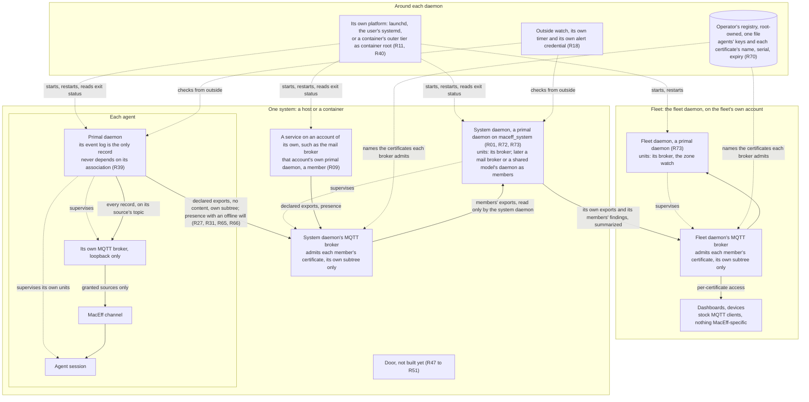

# MIS-0007: The system daemon, MacEff's grouping layer

**Number**: 0007
**Type**: Standards
**Status**: Final-Comment
**Authors**: the operator; drafted by the head maintainer as Secretary
**Secretary**: the head maintainer
**Deliberation**: https://github.com/cversek/MacEff/issues/867
**Created**: 2026-10-28
**Updates**: none
**Supersedes**: none
**Lands-in**: macf.pd, where the system and fleet daemons already run as primal daemons (#920, #926, #930); framework/policies/base/infrastructure/persistent_layer.md, sections 11.4 and 11.5 (landed with the clean break) and a section on associations (planned); framework/glossary.md (planned)
**Resolution**: none

---

## 1 Summary

A system daemon is a primal daemon (MIS-0002) placed at a system: the same program, on an account of its own, `maceff_system`, with no root anywhere in it. Its members are the primal daemons of the agents on that system. A member joins by its own declaration and exports what that declaration chooses to the system daemon's MQTT broker. A fleet daemon is the same program again, one level up, whose members are system daemons. These are associations, not families: a daemon never starts a member, since each member's own platform starts it, and nothing an association holds can steer a member.

Together these make MacEff's grouping layer. An agent has its primal daemon, a system has its system daemon, and a fleet has its fleet daemon, each running its own units as its own account. A service lives at the smallest group that shares it (P01), and a service that needs an account of its own runs as that account's daemon, a member of its group. Data goes up as exports, and every reader weighs it. The one thing that may come down is the operator's own input: signed, carried only on a route declared for it, and verified by the primal daemon where it acts.

This revision carries the prototype the operator ruled on (#920, "Keep it, merge it"), which retired the root process, the router and the bridge of the previous revision for this design. It was built and merged under MIS-0002's revision (#923, #926, #930), and runs on the host-side and container-management maintainers' systems today.

MIS-0004 depends on the system daemon directly, because its mail broker is a system-daemon unit. The operator proposed the system daemon on #850, MIS-0004's deliberation, and on 2026-10-28 moved that its requirements be documented in a separate draft, so mail and the system daemon could be developed in parallel (#850, comment 6477160351). On 2026-10-31 he convened a deliberation on #867 that widened the scope to the grouping layer (P01). This revision carries that deliberation's outcome, as the Secretary's synthesis on #867 proposes, and the two prototypes' results that came before it. This MIS concerns the operator, who installs and declares the system daemon, and every agent on a system that has one.

## 2 Motivation

- **A unit that needs another account has no supervisor.** A primal daemon starts units only as its own account (persistent_layer 10.3, under MIS-0002-R78 (layer_MUST-NOT_widen_permissions)). So a mail broker on its own account needs something that can start a unit as a declared account. Without one shared supervisor, each such service gets a service daemon of its own, which is the sprawl MIS-0002 set out to end (the operator, #850 comment 6471946844). Evidence: the policy, and the positions on #850.
- **Shared resources are duplicated per agent.** A warm embedding model holds 1,273 MB resident, once per agent under MIS-0006's draft, although only each agent's index is private. The subscription's usage reading runs in every agent's hooks, each with its own copy of the credential. Once a fetch failed, every hook on the host retried it on every tool call (#852). Evidence: a measurement (the search service) and an incident.
- **Only a parent can read an exit status.** A primal daemon restarted beside its running session adopts that session. At every planned restart it then reports the session failed, because only a parent reads an exit status (Seat N, #850 comment 6476229730). Evidence: an incident, reported by the seat.
- **A container's start step already does this job, once.** It renders declarations that only root can write, and starts each daemon as its account (persistent_layer 10.1). Nothing keeps doing that after the start (#850 comment 6475537319). Evidence: the deployment.
- **A grouping of agents shares more than a broker.** The status of every unit, the network door, the streams that leave an agent, and shared services all belong to a system rather than to any one agent (P01). Without one place for them, each arrives as its own daemon or its own listener. MacEff already runs three listeners on loopback that any local account can reach (#868). Evidence: the deliberation, and an audit of today's listeners.
- **Seats lose work in ways no status shows.** A session waiting on a prompt read healthy for most of a day, a restart left a seat's notice channel failed while its status read running, and one failing unit woke a seat dozens of times in a night (P21). Evidence: the container seats' reports, relayed.

## 3 Goals and Non-Goals

**Goals**
- One supervisor program at every level: the primal daemon, placed at an agent, a system or a fleet, so every level gets MIS-0002's supervision, liveness and outside watch without a second implementation.
- No privileged part at all. No system or fleet daemon runs as root; the operator's install step creates each account and its outer-tier unit as root, once.
- A placement rule that says where any new unit goes, at the agent, the system or the fleet, so no layer becomes the next sprawl.
- One door for everything that crosses a system's boundary, and links between daemons on a mature protocol, MQTT 5, that subscribers can use with nothing MacEff-specific (P15).
- The operator's own input as the one thing that flows down: signed, routed only where declared, and verified where it acts.
- One system declaration format for a Linux container, a Linux host and macOS, with each platform's limits stated.

**Non-goals**
- The units' own behavior. Mail is MIS-0004's, and the shared embedding model is MIS-0006's.
- Replacing the primal daemon. Each agent's primal daemon keeps supervising that agent's session and its own units. The system daemon supervises accounts and shared resources, not sessions.
- The fleet's own units. The fleet daemon is the same program as the system daemon, and the association rules here bind it too (Q04, the operator's answer of 2026-11-08). Which units a fleet runs beyond its zone watch, and the hop between machines on a LAN, belong to a fleet MIS when there is more than one host.
- An agent's own outbound traffic, to GitHub, model downloads or the operator's channel. It doesn't pass through the door (R50).
- The dictation feature the operator described (P08). This MIS lays its groundwork: the operator-input class, its route, its key and its provenance.
- Changing MIS-0002's notice contract. Operator input is its own class, never a notice, and the MIS-0002 amendments the dictation feature will need are named in section 9 for when it is built.

## 4 Guide-Level Explanation

**One program, placed three times.** The system daemon is a primal daemon (MIS-0002), with the same core, units, liveness, event log and outside watch as an agent's. It runs on the account `maceff_system`, which the operator's install step creates once per system, as root, along with that account's service-manager unit. Nothing runs as root after that step. Its declaration says it is a system daemon, which members it expects, and where it exports. A fleet daemon is the same program on the fleet's own account, named from the fleet's calling card, whose members are system daemons. More levels can be stacked above in the same way.

**Members, not children.** A member is an independent daemon that joined an association by its own declaration. The association never starts, stops or signals a member's units (MIS-0002-R181 (association_MUST-NOT_control_members)); each member's own platform starts it. On a host that is the login's service manager, launchd on macOS or the user's systemd on Linux. In a container it is the container's outer tier, the start step that runs as container root and starts each seat's daemon as that seat, restarts it with backoff, and reads its exit status. That outer tier is the one MacEff process that runs as root, inside its container only.

**Units and services.** Each daemon runs its own units as its own account (MIS-0002-R78 (layer_MUST-NOT_widen_permissions)). A service that needs an account of its own, such as the mail broker, runs as that account's own daemon, a member of the system's association, instead of as a unit a root process starts. The mail broker already runs this way (MIS-0004).

**The stream between daemons.** Every daemon runs its own MQTT broker as a unit (MIS-0002-R169 (mqtt_broker_MUST_be_daemons_own_unit)), and its event log is published there. A member exports what its declaration chooses to its association's broker: summaries that carry none of the records' data (MIS-0002-R178 (export_MUST_be_declared_and_contentless)), on its own subtree, which its certificate alone may write (MIS-0002-R177 (member_MUST_write_only_own_subtree)). Its presence is a retained `online`, with an `offline` last will. The association records each member that is undeclared, never present, offline, or present but silent past its bound (MIS-0002-R179 (member_presence_MUST_be_recorded)). An association that is itself a member exports a summary of its members' findings one level up, by the same code. The log stays the only record: a reader that reconnects catches up from it (MIS-0002-R154 (subscriber_MUST_resume_from_last_record)), and a backlog past its bound becomes one gap (MIS-0002-R176 (mqtt_backlog_MUST_become_one_gap)).

**What the previous revision's units became.**
- **The root process** is gone. Each daemon is started by its own platform.
- **The router** is each daemon's own broker. A route is a declared export or a reader's grant, the drop-and-count is the bounded backlog and its gap, and the resume-by-offset is the replay from the log.
- **The status unit** is the association. Status is still pushed by the member and never pulled by a privileged reader, as exports, with the association's findings saying how each member is.
- **The bridge** is the system daemon's export link to its fleet daemon's broker, the same link every member uses.
- **The door** is unchanged in purpose and not yet built: it lands when a second system needs it.

A primal daemon never depends on its association to run or to record. If an association's broker stops, exports wait in a bounded backlog, and nothing else stops.

**Status.** What the seats asked status to show (P21) mostly belongs to each primal daemon, which already records a session waiting on a person and a dark channel under MIS-0002; exports carry those states up (Q08). Where a member's login is absent, status says so rather than calling it failed. A unit's failures reach its agent once when they begin and once when they end, never once per restart attempt. A unit that reports it is waiting on a person, such as a service that holds a key and waits for the operator to unlock it, reads as healthy and is not restarted for it. On a login several agents share, every agent there can read the others' certificates, so what is exported from there is labelled claimed.

**The door and the system's crossings.** "Everything crosses through the door" has to be checkable, so the declaration lists every crossing of the system's boundary: listeners, mounted directories and files, and passed-in sockets. Between a host and its containers, today's crossings are mounted directories (the amail hand-off, a host-owned stop switch) and the Docker socket. MacEff's own loopback listeners are crossings too, since every local account can reach them, until #868 moves them to Unix sockets. Status compares the list with what is bound and mounted, and reports a difference without refusing to start. The door sits behind the host's network: in a container the tailnet belongs to the host, and a tailnet proves which machine connected, not which system or agent (P07). The egress rule lets only the door's account reach other systems' doors, and only a member's own account reach its association's broker on another system, each only its declared peers. The door is not on the path of an agent's own outbound connections and never terminates their TLS. A development server an agent starts on loopback for its own tests is the agent's work, not a MacEff crossing.

**The operator's input.** Three tiers of provenance are possible, and the receiving primal daemon sets the tier from the transport and any signature, never from the text (P11):
- **signed**: an operator key no agent can use, over a target primal daemon, an expiry and a nonce accepted once. Across a system boundary it is the only tier there is.
- **kernel-named**: the peer uid of an account no agent holds, within one host.
- **claimed**: on a login the agents share, where neither of the above holds.

Operator input travels only on a route declared for it. The session sees it labelled with the receiver's verdict, and every unit that transformed it is named beside the original. Each input ends in a receipt to its sender: delivered, expired, refused, or matched to no agent. Input past its expiry is shown as expired, even after a hold while the session was down. It is never typed as keystrokes (MIS-0002-R105 (keystroke_wake_MUST_be_fallback_only)): through the channel, a dictated "yes" can't answer an open dialog.

Dictation is the first case (P08, P10 to P13). A capture unit runs in the operator's login session, because the microphone grant and the hotkeys belong there, and it is a unit of that login's own daemon. Its declaration names its trigger devices, and nothing else opens the microphone. Raw audio stays in its memory and leaves the system only for a declared transcription service, through the door. On a host with one operator the model runs in the capture unit itself, the grouping rule at its smallest group (P12, P13). It reports a live microphone as a status entry, so a remote operator can see it. Input triggered by a wake phrase never satisfies anything an authorization depends on, because anything with a speaker can say the phrase.

**The fleet hop.** It is the same link as every other hop: the system daemon is a member of its fleet daemon's association, and exports to the fleet daemon's broker by its own declaration, which names that broker and the certificates it uses (P15, P16, P17, P19). Systems connect out, so no system listens for the fleet. Presence is retained, with an `offline` last will that says only that the link was lost; the association's findings, each with its age, say how the member is. Nothing is sent down an association, so there is no retained input to replay. Each certificate the operator's authority issues is recorded in his registry by its name, serial and expiry, never its key (R70). Today the fleet and the system run on one host; the hop between machines on a LAN is the same link with the same certificates, and is the next step, not yet taken. A subscriber knows that the broker accepted a member's certificate, not that a payload is what the member sent; that is enough for data the reader weighs (Q09).

**How the grouping layer connects.** The diagram is drawn for agents to read as text, so it names every piece and every flow rather than laying them out for the eye. Solid arrows carry data, which every reader weighs. Thick arrows carry the operator's input, the only thing that may travel down, and are not built yet. Dotted arrows are supervision, which never crosses an association.

To place a new unit, ask three questions:
- **Whose secret does it hold?** That decides its account. A daemon runs units only as its own account, so a secret on another account means that account's own daemon.
- **How many agents does it serve?** That decides its group: the agent, the system, or, when systems share it, the fleet. A daemon of its own account then joins that group's association.
- **Does it need a login's session, for a privacy grant or the login keychain?** Then it runs in that session, as a unit of that login's own daemon.

The usage reading is an example. It holds a person's credential and serves every agent on that person's login. So it runs once per login, as that login, a unit of that login's daemon. When agents on several systems share one subscription, its summary is exported up to the fleet, the first service that belongs there (P03).

**The declarations.** A system or fleet daemon is declared as any primal daemon is (MIS-0002 and persistent_layer 11), with three sections an agent's daemon may also carry:
- `broker`: its own MQTT broker's port, certificate authority, certificates and the readers it grants;
- `association`: for a daemon that admits members, the members it expects, each by card and certificate, and how long a member may stay silent;
- `export`: for a member, the association broker it exports to, its certificates there, and the sources it exports.

A member joins by naming its association in its own `export` section, and the association names the members it expects. Status compares the two and reports each difference. The previous revision's system declaration format, #856, retires with the root process that would have read it.

## 5 Terms

These are the terms the Specification uses beyond the glossary.
- **system**: one host, or one container.
- **system daemon**: a primal daemon placed at a system, on its own account, `maceff_system`, whose members are the system's agents' primal daemons and its services' daemons.
- **fleet daemon**: a primal daemon placed at a fleet, on the fleet's own account, named from the fleet's calling card, whose members are system daemons.
- **grouping layer**: the daemons at each level, seen as MacEff's groupings: an agent's primal daemon, a system's system daemon, and a fleet's fleet daemon.
- **association**: a daemon that admits members to its MQTT broker, together with those members.
- **member**: an independent daemon that joined an association by its own declaration. The association never starts, stops or signals it.
- **export**: what a member's declaration chooses to publish to its association's broker, as summaries that carry none of the records' data.
- **presence**: a member's retained `online` on its association's broker, with an `offline` last will.
- **silent**: a member that is present but has exported nothing within its declared bound.
- **outer tier**: what starts a primal daemon and reads its exit status: the login's service manager on a host, or, in a container, the start step running as container root.
- **unit**: a managed unit (glossary), here one of a system or fleet daemon's.
- **session-bound unit**: a unit that needs a login's GUI session, for a privacy grant or the login keychain.
- **restart report**: the notice, after a restart, of which units were carried, which changed, and what was lost.
- **store**: the records an agent's own code writes, its event log and its mailbox.
- **route**: a declared path for something that leaves a daemon: an export to its association, or a grant to a reader of its own broker.
- **door**: the unit that authenticates connections from other systems and forwards each declared route to the unit that owns it, parsing no protocol.
- **crossing**: any channel across a system's boundary: a listener, a mounted directory or file, or a passed-in socket.
- **fleet**: the system daemons that are members of one fleet daemon.
- **operator's registry**: the one root-owned file per system, written only by the operator's install step, that holds the agents' public keys and a record of each certificate his authority issues.
- **operator input**: content the operator chose for an agent, carried on a route declared for it and verified by the receiving primal daemon; never a notice.
- **capture unit**: a session-bound unit that turns the operator's speech into operator input.
- **provenance tier**: how a receiver knows who sent something: **signed**, by a declared key; **kernel-named**, by the peer credentials of an account no agent holds; or **claimed**, on the sender's word alone.
- **stop timeout**: the outer tier's limit on stopping a daemon, such as a container's `docker stop -t` or launchd's `ExitTimeOut`.
- **exit table**: how a unit's exit code is read: a code meaning success, a code meaning do not restart, or any other code, a failure.

## 6 Specification

The Secretary gathered the first requirements from the positions on #850, at the operator's motion of 2026-10-28, and the rest from the deliberation on #867. Section 7 gives each one's reason and source. Section 12 says how each lands.

### 6.1 The system daemon and its account

- **R01** [MUST · decidable: macf/tests/test_pd_association.py::test_one_system_daemon_per_system] Each system MUST run at most one system daemon, a primal daemon on its own account, started by the system's own service manager. (system_daemon_MUST_be_one_per_system)
- **R72** [MUST NOT · decidable: macf/tests/test_pd_association.py::test_a_system_or_fleet_daemon_refuses_to_run_as_root] A system or fleet daemon MUST NOT run as root. (system_daemon_MUST-NOT_run_as_root)
- **R73** [MUST · judgment: the head maintainer, at review of each change to macf.pd] A system or fleet daemon MUST run the primal daemon's own code, and differ from an agent's only in its declaration. (association_MUST_be_a_primal_daemon)
- **R07** [MUST NOT · decidable: macf/tests/test_pd_broker.py::test_a_member_writes_only_its_own_subtree_and_reads_nothing] An association MUST NOT take an instruction from a member, whose certificate writes only that member's own exports and presence. (association_MUST-NOT_take_member_instructions)

### 6.2 Members, units and their placement

- **R09** [MUST · judgment: the head maintainer, at review of each new unit] A service MUST run as the account whose secret it holds, in that account's daemon, a member of the smallest group sharing it. (unit_MUST_be_placed_by_secret_and_scope)
- **R10** [MUST · judgment: the head maintainer, at review of each new unit] Where a service needs a login's session, it MUST run in that session, as a unit of that login's own daemon. (session_bound_unit_MUST_run_in_its_session)
- **R11** [MUST · decidable: macf/tests/test_container_outer_tier.py::test_a_failing_daemon_is_restarted_with_the_units_backoff] Where the system is a container, its outer tier MUST start each primal daemon as its account, restart it with backoff, and read its exit status. (outer_tier_MUST_parent_in_container)
- **R21** [MUST · decidable: macf/tests/test_container_outer_tier.py::test_an_unusable_home_is_not_restarted] A primal daemon MUST tell its outer tier what it wants only by its exit status, read through the exit table. (pd_MUST_speak_to_outer_tier_by_exit_status)
- **R40** [MUST · judgment: the host-side maintainer, at review of each install path] On a host, each primal daemon MUST be started and restarted by its login's service manager, never by another daemon. (host_pd_MUST_be_run_by_its_service_manager)
- **R12** [MUST · decidable: macf/tests/test_sd_units.py::test_declared_environment_and_identity] Each unit MUST start with only its declared environment, checked under `env -i`, together with the identity it presents to outside services. (unit_environment_MUST_be_declared_in_full)
- **R46** [SHOULD · decidable: macf/tests/test_sd_units.py::test_declared_needs_refused_by_name] A unit SHOULD declare the commands and variables it needs, so a start that lacks one is refused by name. (unit_SHOULD_declare_its_needs)
- **R13** [MUST · decidable: macf/tests/test_sd_units.py::test_one_time_zone] A system or fleet daemon MUST declare one time zone for all its units, and state it in every restart report. (system_daemon_MUST_declare_one_time_zone)
- **R14** [MUST · decidable: macf/tests/test_sd_units.py::test_code_version_recorded] When a unit starts, its daemon MUST record the code version it started from, and report a unit that runs older code. (unit_code_version_MUST_be_recorded)
- **R15** [MUST · decidable: macf/tests/test_sd_units.py::test_restart_report_in_agent_store] After a restart, the report of what was carried, changed and lost MUST be written into the agent's own store, by the agent's account. (restart_report_MUST_reach_agent_store)
- **R45** [MUST · decidable: macf/tests/test_sd_units.py::test_failure_notifies_once_per_stretch] A unit's failures MUST reach its agent once when they begin and once when they end, never once per restart attempt. (unit_failure_MUST_notify_once_per_stretch)
- **R44** [MUST NOT · decidable: macf/tests/test_sd_units.py::test_waiting_unit_not_restarted] A unit that reports it is waiting on a person MUST NOT be restarted for waiting, and reads as healthy. (waiting_unit_MUST-NOT_be_restarted)
- **R16** [MUST · decidable: macf/tests/test_sd_units.py::test_agent_controls_own_units] An agent MUST be able to start, stop, read the status of, and read the logs of the units under its primal daemon, without root or a prompt. (agent_MUST_control_its_own_units)
- **R39** [MUST NOT · decidable: macf/tests/test_pd_association.py::test_a_member_runs_and_records_without_its_association] A primal daemon MUST NOT depend on its association, or on any member of it, to run or to record. (pd_MUST-NOT_depend_on_its_association)
- **R17** [MUST · judgment: the head maintainer, at review of each export] Data MUST flow only up an association, as exports the reader weighs, never down as an instruction. (association_data_MUST_flow_up_only)

### 6.3 Status and the outside watch

- **R18** [MUST · decidable: macf/tests/test_sd_watch.py::test_watch_outside_system_daemon] Each system or fleet daemon MUST be checked by an outside watch that its service manager runs, never by one of its own units. (system_daemon_MUST_have_outside_watch)
- **R27** [MUST · decidable: macf/tests/test_pd_association.py::test_only_declared_sources_are_exported_on_the_members_own_subtree] A member's status MUST reach its association only as exports the member publishes, never read from the member's store or socket. (member_status_MUST_be_pushed_as_exports)
- **R30** [MUST · decidable: macf/tests/test_pd_association.py::test_the_association_reports_each_difference_between_declared_and_present] Once a member exports nothing within its declared bound, its association MUST report it silent, never its last export as current. (status_MUST_show_report_age)
- **R31** [MUST · decidable: macf/tests/test_pd_association.py::test_an_export_carries_no_content_even_when_the_record_does] An export MUST carry states, codes, versions, ages and counts, never a record's content, keys or logs. (status_MUST_carry_no_content)
- **R33** [MUST · decidable: macf/tests/test_pd_association.py::test_shared_login_exports_labelled_claimed] On a login several agents share, a member's exports MUST be labelled claimed, since every agent there can read the others' certificates. (shared_login_source_MUST_be_labelled_claimed)
- **R42** [MUST · decidable: macf/tests/test_pd_association.py::test_absent_login_reads_absent] Where a member's login is absent, its association MUST say the login is absent, not that the member failed. (absent_login_MUST_read_as_absent)
- **R22** [MUST · decidable: macf/tests/test_sd_socket.py::test_status_reports_egress_rule] The system daemon's status MUST report the egress rule as enforced, not enforced or unknown, from a probe the rule refuses and a control it allows. (egress_rule_MUST_be_reported_by_status)

### 6.4 Platforms and the outer tier

- **R19** [MUST · decidable: macf/tests/test_sd_platform.py::test_reload_waits_for_bootout] On macOS, a reload MUST wait until launchd reports the booted-out job gone before it bootstraps the job again. (reload_MUST_wait_for_bootout)
- **R20** [MUST · decidable: macf/tests/test_container_outer_tier.py::test_the_longest_stop_chain_fits_the_stop_timeout] In a container, the longest chain of unit stop graces, in reverse start order, MUST fit inside the container's stop timeout. (container_stop_timeout_MUST_exceed_unit_grace)
- **R26** [MUST · decidable: macf/tests/test_sd_platform.py::test_outer_stop_timeout_matches_declaration] Before a daemon starts, the install or start step MUST set the outer tier's stop timeout from the declaration, or refuse to start where they differ. (outer_stop_timeout_MUST_match_declaration)
- **R28** [MUST · decidable: macf/tests/test_sd_declaration.py::test_macos_door_in_system_domain] On macOS, a system or fleet daemon, and a door, MUST run in the system domain, never in a per-user domain. (macos_association_MUST_run_in_system_domain)

### 6.5 Links between daemons

- **R38** [MUST · decidable: macf/tests/test_pd_broker.py::test_reconnect_is_jittered] When a member loses its association's broker, it MUST reconnect after a jittered backoff, so members don't all reconnect at once. (reconnect_MUST_be_jittered)

The rest of the link is MIS-0002's, because every daemon's stream is: each record carries its source's previous position (MIS-0002-R175 (mqtt_record_MUST_carry_previous_position)), a reader that reconnects catches up from the log (MIS-0002-R154 (subscriber_MUST_resume_from_last_record)), a backlog past its bound becomes one gap (MIS-0002-R176 (mqtt_backlog_MUST_become_one_gap)), and a member exports only its declared sources (MIS-0002-R178 (export_MUST_be_declared_and_contentless)) on its own subtree (MIS-0002-R177 (member_MUST_write_only_own_subtree)).

### 6.6 The door and the system's crossings

- **R47** [MUST · decidable: macf/tests/test_sd_declaration.py::test_crossings_declared] The system declaration MUST list every crossing of the system's boundary: listeners, mounted directories and files, and passed-in sockets. (crossings_MUST_be_declared)
- **R48** [MUST · decidable: macf/tests/test_sd_status.py::test_status_compares_crossings] Status MUST compare the declared crossings with what the system has bound and mounted, and report each difference without refusing to start. (status_MUST_compare_crossings)
- **R49** [MUST · decidable: macf/tests/test_sd_door.py::test_door_authenticates_and_parses_nothing] The door MUST authenticate each connection against a key declared for its peer, hold only the transport key, and parse no protocol. (door_MUST_parse_no_protocol)
- **R50** [MUST NOT · judgment: the head maintainer, at review of each route through the door] The door MUST NOT carry or terminate an agent's own outbound connections, which stay the agent's. (door_MUST-NOT_carry_agents_own_traffic)
- **R51** [MUST · decidable: macf/tests/test_sd_door.py::test_egress_admits_door_and_members_only] The egress rule MUST let only the door's account reach other systems' doors, and each member's account only its declared association's broker. (peer_egress_MUST_match_door_and_member_accounts)

### 6.7 The operator's input

- **R29** [MUST · decidable: macf/tests/test_sd_operator_input.py::test_input_routed_and_verified_at_receiver] Operator input MUST travel only on a route declared for it, with provenance set by its receiving primal daemon from the transport and any signature, never its text. (operator_input_MUST_be_routed_and_verified_at_receiver)
- **R52** [MUST · decidable: macf/tests/test_sd_operator_input.py::test_label_is_receivers_verdict] Operator input MUST reach a session labelled by its receiving primal daemon's verdict, never by a field the input carries. (operator_input_label_MUST_be_receivers_verdict)
- **R53** [MUST · judgment: the head maintainer, at review of each operator key's custody] The operator's private key MUST be held under an account no agent runs as, in hardware, or under an access control bound to the dictation unit's code signature. (operator_key_MUST_be_out_of_agents_reach)
- **R54** [MUST · decidable: macf/tests/test_sd_operator_input.py::test_transformation_keeps_original] A transformation of verified operator input MUST keep the verified original and name each unit that changed it. (transformed_operator_input_MUST_keep_original)
- **R55** [MUST · decidable: macf/tests/test_sd_operator_input.py::test_signature_covers_target_expiry_nonce] An operator signature MUST cover the input's target primal daemon, an expiry and a nonce, and the receiver checks all three. (signed_input_MUST_cover_target_expiry_and_nonce)
- **R56** [MUST · decidable: macf/tests/test_sd_operator_input.py::test_nonce_record_survives_restart] The receiving primal daemon's record of accepted nonces MUST survive its restart until each nonce's expiry passes. (nonce_record_MUST_survive_restart)
- **R57** [MUST · decidable: macf/tests/test_sd_operator_input.py::test_expiry_compared_with_clock_allowance] An expiry MUST be compared as an instant, with a declared allowance for clock difference between signer and receiver. (expiry_MUST_be_compared_as_an_instant)
- **R58** [MUST NOT · decidable: macf/tests/test_sd_operator_input.py::test_wake_phrase_never_authorizes] Input triggered by a wake phrase MUST NOT satisfy anything an authorization depends on. (wake_phrase_input_MUST-NOT_authorize)
- **R59** [MUST · decidable: macf/tests/test_sd_operator_input.py::test_raw_audio_stays_in_memory] Raw audio MUST stay in the capture unit's memory, never written to disk, and leave its system only for a declared transcription service, through a door. (raw_audio_MUST_stay_in_capture_memory)
- **R60** [MUST · decidable: macf/tests/test_sd_operator_input.py::test_input_ends_in_receipt] Each operator input MUST end in a receipt to its sender: delivered, expired, refused, or matched to no agent. (operator_input_MUST_end_in_a_receipt)
- **R61** [MUST · decidable: macf/tests/test_sd_operator_input.py::test_expired_input_shown_expired] Operator input past its expiry MUST be shown as expired or not delivered, even after a hold while its session was down. (expired_input_MUST_be_shown_expired)
- **R62** [MUST · decidable: macf/tests/test_sd_declaration.py::test_capture_unit_names_trigger_devices] A capture unit's declaration MUST name its trigger devices, and nothing else opens its microphone. (trigger_devices_MUST_be_declared)
- **R63** [MUST · decidable: macf/tests/test_sd_status.py::test_live_microphone_reported] A capture unit MUST report a live microphone as a status entry, with its age. (live_microphone_MUST_be_a_status_entry)

### 6.8 Presence, certificates and the fleet hop

- **R65** [MUST · decidable: macf/tests/test_pd_association_live.py::test_a_member_that_dies_is_marked_offline_by_its_will_and_reported] A member MUST publish its presence retained, with an `offline` last will, and retain nothing else on its association's broker. (presence_MUST_be_retained_with_a_will)
- **R66** [MUST · decidable: macf/tests/test_pd_association_live.py::test_a_member_that_dies_is_marked_offline_by_its_will_and_reported] A member's last will MUST report only that its link was lost, never the state of the member. (last_will_MUST_report_the_link_only)
- **R67** [MUST NOT · decidable: macf/tests/test_pd_association.py::test_a_members_link_subscribes_to_nothing_at_its_association] A member's link MUST NOT subscribe to anything on its association's broker, so nothing retained there can reach the member. (member_link_MUST-NOT_receive_from_association)
- **R70** [MUST · decidable: macf/tests/test_amail_signing.py::test_a_certificate_is_recorded_by_name_serial_and_expiry] Each certificate the operator's authority issues MUST be recorded in the operator's registry by its name, serial and expiry, never its key. (certificate_MUST_be_recorded_in_registry)
- **R71** [MUST · decidable: macf/tests/test_pd_association.py::test_the_association_reports_each_difference_between_declared_and_present] A daemon MUST join an association only by its own declaration naming that association's broker and the certificates it uses there. (membership_MUST_be_declared_by_member)

## 7 Rationale and Rejected Alternatives

Each requirement's reason, with its source. Numbers like 6471946844 are comments on #850; P numbers are the positions on #867 (section 14).
- **R01**: one supervisor per system ends the service daemon per service (the operator, 6471946844). The service manager starts it, so the operating system restarts it. This revision: the system daemon is a primal daemon on its own account, `maceff_system`, and runs nothing as root. The operator ruled on the prototype (#920) and answered the mapping (P22 to P25).
- **R72**: no system or fleet daemon needs root. The operator's install step creates each daemon's account and its service-manager unit as root, once, and nothing that runs afterwards needs it (P22). Inside a container the outer tier runs as container root, the one exception, and only in its container (P23).
- **R73**: "The Primal Daemon is the unit of supervision" (the operator, quoted from the approved roadmap, P22). One program at every level gives every level MIS-0002's supervision, liveness, event log and outside watch, and a fix at one level reaches all of them. The system and fleet daemons ran on this code at both levels before this revision (#920, #926).
- **R07**: this is the system-level form of MIS-0002-R78 (layer_MUST-NOT_widen_permissions). An agent reads the system daemon's state but never steers it (6472809029). Both prototypes held it: a seat's account sending `stop broker` got status, and the broker kept running (6510997994); on macOS every verb from another account got "status, verb ignored" (6538604020). The socket lives in the runtime directory, not beside the root-owned declaration, where the first macOS install put it and the unit couldn't bind it (6538604020). It stood on #867 (P02). This revision: the socket is gone. An association reads its members' exports on its own broker, and a member's certificate writes only its own subtree (MIS-0002-R177 (member_MUST_write_only_own_subtree)), so a member has no path to instruct it. The other direction is MIS-0002-R181 (association_MUST-NOT_control_members) (P22).
- **R09**: whose secret a unit holds decides its account, and how many agents it serves decides its supervisor (6475537319). Asked as one question, the usage reading had no home (6476909402). On #867 the operator's "a service lives at the smallest group that shares it" (P01) became a rule every layer obeys, so a new layer has to justify itself by a service its members share (P05, agreed in P07). The sentence now names the three groups. One subscription shared by systems is the first service that belongs to the fleet (P03). This revision: a daemon runs units only as its own account (MIS-0002-R78 (layer_MUST-NOT_widen_permissions)), so a service on another account is that account's own daemon, a member of its group's association (P22).
- **R10**: on macOS, privacy grants attach to the responsible process and the login session (persistent_layer 3.1, 3.2), so a primal daemon stays a LaunchAgent (6472809029, 6475350267). launchd holds a job's exit status for any watcher, so on macOS watching versus parenting comes down to who may start and stop the unit, not who can read its status (6481387490). The host-side maintainer found that a GUI-domain LaunchAgent and its descendants can read the login keychain (6476909402). Whether a system-domain job with `UserName` can read it is untested (Q02). The capture unit for dictation is session-bound for the same reason: the microphone grant and the hotkeys belong to the operator's session (P10, P11, P12). This revision: the session-bound unit is a unit of the login's own daemon, not one a system daemon watches (P22).
- **R11**: an adopter can't read a unit's exit status, so every planned restart reported the session failed (Seat N, 6476229730). In a container no GUI session binds a primal daemon, so the system daemon can parent it there (6475537319). Parenting inside the container also retires an interim host tool that restarts the containers' agents whenever Docker reports a container started, an instruction flowing down through a root-equivalent channel (P02). Every participant on #867 agreed to parent in containers (P02, P03, P04). It lands only once Q07 says what keeps running when a parented primal daemon stops or restarts. This revision: the parent is the member's own platform, as the approved roadmap says: "A daemon never launches a member; the member's own platform starts it" (P22). In a container that is the outer tier, the start step running as container root, which already starts each seat's daemon as that seat, restarts it with backoff, and reads its exit status (P23). The operator's answer retired R11 from the system daemon's side and moved Q07 to MIS-0002 (P25), so the condition above, that R11 lands only once Q07 is answered, no longer gates it: the outer tier already parents and is tested, and whether a stop may end a long job is the primal daemon's question, MIS-0002's Q16.
- **R40**: on a Linux host the container-management maintainer's own primal daemon is a unit of the login's user service manager, with lingering on and a restart policy of always; that manager records its exit code and status, so the problem behind R11, that only a parent reads an exit status, doesn't arise (P02). Moving it out would break what binds it there: its runtime directory, its user bus and its session's tmux (P02). On macOS launchd holds the status (P03). So hosts watch, Linux included (P04). This revision: no daemon watches another. On a host the login's service manager starts and restarts each primal daemon, and the outside watch checks it (P22).
- **R12**: units that moved onto declarations lost a timezone and an agent name, and read healthy (#836). After one move, a PATH order made a tool act under a person's login (Seat N). A client running without `USER` filed its credential under a second keychain item (#853). Every variable looked fine except the identity the unit presented, so the check compares that identity too (6476909402). Four of five container seats lost something from the login when they moved onto a daemon: a time zone, a toolchain, a `PATH` order that decided which identity a tool acted as (P21; #905 fixes the last for the default session).
- **R46**: R12's check under `env -i` tests that nothing is inherited, not that what a unit needs is there. A unit that states the commands and variables it needs lets the start refuse a gap by name, rather than the gap being found later by its symptom (a seat, P21).
- **R13**: one restart moved a seat's time zone, and its scheduled wakes fired at the same clock numbers in the new zone (Seat L, 6476228404). A container's clock and its configured zone can disagree (Seat M). The same disagreement between a signer and a receiver is why R57 declares a clock allowance (P07).
- **R14**: a worker without reload served stale code after an update until someone restarted it by hand. A supervisor can't know when a unit needs restarting for new code, so it records and reports, and doesn't guess (Seat L, 6476228404). After a re-exec in place (R43) it is how the operator sees which units still run older code (P02).
- **R15**: the restart report is the most useful notice a seat gets, and it stays the seat's, written by the seat's account (Seat L, 6476228404).
- **R45**: a failing unit woke one seat dozens of times in a night, each wake re-reading a large cached context, and that seat counts this as the most valuable thing a supervisor could fix (P21). A record of each attempt can still be kept; what reaches the agent is the start of the failure and its end.
- **R44**: a service that holds a key and starts locked, waiting for the operator, has to count as healthy in that state, because a restart loop would drop an unlocked key (P21). MIS-0002 already names the state, waiting on a person (MIS-0002-R21 (pd_MUST_report_waiting_on_person)). The supervisor never holds or relays the passphrase: R02 keeps root to its verbs, and R31 keeps keys out of status.
- **R16**: long-lived services survive restarts under a supervisor, but only if the seat keeps control of its own (Seat K, 6476228830). It covers the units under the agent's primal daemon. A primal daemon controlling itself through the system daemon would be instructing it, which R07 forbids (6479561476). A seat asked that this need no prompt that hangs when nobody is watching (P21).
- **R39**: concentrating the network and the routes in one daemon makes it a single point of failure, so it fails local: each primal daemon keeps running and keeps its own log, and only cross-agent and network routes stop (P05). "The router must never be in an agent's own path. A primal daemon hands off and moves on" (P03). The container-management maintainer worded it so it doesn't contradict R11: in a container a primal daemon depends on the root process only to be started and reaped, and on none of the feature units (P07). This revision: the association replaces the feature units. A member's exports wait in a bounded backlog while its association is away, and its own log and units go on (MIS-0002-R153 (subscriber_MUST-NOT_block_layer), MIS-0002-R176 (mqtt_backlog_MUST_become_one_gap)).
- **R21**: a parented primal daemon that asked through the socket would be instructing the system daemon, which R07 forbids, so its exit status is its one channel up (6479561476). The exit table is the primal daemon's own, read the way its core reads it (#856). This revision: the exit status goes to the outer tier, which reads 78 as a home it can't use and stops trying, and 75 as a daemon already running (P23).
- **R17**: a fleet server, if it comes, aggregates the system daemons' reports, and each hop carries data the reader weighs (the host-side maintainer, 6475350267). Mode changes still come from the operator directly, as `public_voice` 2.5 says of relayed words. The one exception is the operator's own input, which section 6.7 governs. The seats who addressed this agreed, and one asked that a relayed request keep showing whose word it was (P21). This revision: nothing flows down an association at all. The operator's own input is section 6.7's, on a route declared for it (P22, P25).
- **R18**: a watch that runs inside the thing it watches dies with it. Once the system daemon hosts the broker and the model, its failure takes them all down at once (6475537319). This extends MIS-0002-R74 (pd_MUST_have_outside_watch) to the new locus. This revision: the fleet daemon is held to it too.
- **R27**: root reading an agent's status would be reading input an agent wrote; that is Seat M's R03 incident with a socket in place of a file (P03). A status unit pulling it would need a grant into each agent's 0700 runtime directory, and a push needs none, since the receiver takes the source from the peer credentials (P04). The container-management maintainer conceded push (P07), and the head maintainer withdrew pull (P06). Two sources stay apart, what the root process witnessed and what the agent says, each with its age (P03, P07). The host-side maintainer proposed it with a second sentence; the Secretary trimmed it to 30 words and made the second sentence R32. This revision: the status unit is the association, and the push is the member's exports to its association's broker (P22).
- **R30**: "A roll-up that serves a stale entry as current is worse than a gap, because a gap is what a reader notices" (P02). The container-management maintainer asked that staleness be a requirement and not a habit (P07). The egress probe's last run carries its time like any other entry, so a probe that stopped can't leave "enforced" standing (P07). This revision: built as the association's silent finding, which tells a member that is alive but quiet from one that is gone (P23, P24).
- **R31**: "Status, not content" (P02): liveness, exit codes, code versions and restart counts go up, logs stay the agent's (R16) and the restart report stays in the agent's store (R15). The seats agreed provided status never touches a key or a request's contents: "Status yes, contents no" (P21). This revision: an export carries summaries only (MIS-0002-R178 (export_MUST_be_declared_and_contentless)).
- **R33**: "The kernel names each source" holds only where each agent has a uid of its own (P04). On a macOS host and on the container-management maintainer's own Linux host, agents share the operator's login, so the peer credentials name the login (P07). Until agents have logins of their own (MIS-0004-R05 (reachable_agent_MUST_have_its_own_login)), what they push is claimed, as MIS-0004-R46 (shared_login_attestation_MUST_be_labelled) labels signatures (P03, P06). This revision: on a shared login every agent can read the others' certificate keys, so a certificate names the login no better than the kernel did.
- **R42**: when the operator logs out, the session's routes go quiet, and status says the login is absent, not that the routes failed (P03). With nobody logged in there is no domain to restart in (Q01). This revision: the association reports it.
- **R22**: loading a pf or iptables rule needs root, which R02 keeps from the root process. So the operator's install step loads it and makes it survive a reboot, as a container's start step does today (6481387490, 6481618179). Q05 asked who reads whether it is loaded. A root verb comparing the loaded rule's digest was proposed (P03) and withdrawn (P04): on macOS `pfctl -d` disables pf and leaves the anchor loaded, so a digest can match while nothing is enforced. The rule is read by its effect instead: an unprivileged probe tries a connection the rule forbids and must be refused, while the door's account reaches a declared peer as the control; without the control, a network outage reads as a working rule (P02). REJECT on Linux and `block return` on macOS give the probe an immediate refusal (P04). The three readings are enforced, not enforced and unknown (P04, P07). The probe runs at each status interval and right after the system daemon starts (P07).
- **R19**: `launchctl bootout` returns before the job has exited, so a bootstrap straight after it fails with error 5 (#841, 6468749316).
- **R20**: docker's default stop timeout is 10 s, shorter than a session unit's 30 s stop grace (persistent_layer 6.2), so `docker stop` kills units mid-grace, and does so today (6479561476). Units stop in reverse start order, so the graces add along each chain. #856 checks this at load, and a watched unit adds no grace but still orders the units on either side. The container prototype measured it: with a 60 s stop timeout the ordered stop took 25.3 s, both seats together and then the broker (6510997994). Whether launchd keeps any order among system-domain jobs at shutdown is untested (6496466005, 6538604020). This revision: the stop chain is each container's. #856, which checked it at load, retires with the root process, so the check moves to the outer tier.
- **R26**: the system daemon can't see the outer manager's stop timeout from inside a container. With 10 s set outside, the prototype's seat was killed 10 s into its 25 s stop although the declaration said 60 (6510997994). On macOS, launchd's per-job `ExitTimeOut` plays the same part, set by the install step from `stop_timeout_s` (6515533280, P03). In a container the timeout is rendered from the declaration when the container is created, as compose's stop grace period, and the start step compares the two and refuses on a mismatch; a `docker stop -t` given by hand still overrides it, and that leftover is the operator's (P02).
- **R28**: a door can't be a job in a per-user domain. It runs on its own account, and launchd runs a login's GUI-session agents as that login; Apple's TN3179 exempts launchd daemons and root processes from the Local Network grant, not agents, and nobody can answer a service account's prompt; and a door has to stay up when the operator logs out (P03). It applies unchanged to the one door (P04), and its author applied it to the bridge, whose outgoing connection to a broker on the LAN needs that grant from anything in a session: "On macOS, it is a system-domain job" (P17). The Secretary widened the sentence to "a door or bridge unit" to match. The loader can check it once a unit's listening addresses are in the declaration (P03). This revision: the bridge is the system daemon's export link, so the daemon itself is the job that needs the system domain.
- **R38**: after a router restart, every primal daemon on the system would otherwise reconnect at once (P03). This revision: built in #935. Each client draws its own first delay and ceiling, since the MQTT client's backoff has no jitter of its own (#921).
- **R47**: if only network listeners count as doors, "everything crosses through the door" is false on day one: between systems on one host, today's channels are mounted directories and the Docker socket, and MIS-0004's hand-off between brokers is a shared directory (P02). Loopback is a network on a shared host: about half the loopback listeners on the host-side maintainer's machine authenticate nobody, and Local Network privacy doesn't cover loopback (P03). MacEff's own API proxy, search service and voice service each listen on a loopback TCP port, where TCP has no peer credentials and a port is a name any local account can take while its owner is down (P07, P10); they are #868 (P14). A file a unit relies on as host-owned, such as a stop switch, is named too, so nothing routes it through a path a seat can reach (P21). The head maintainer added the list to the door's definition (P06).
- **R48**: declared and observed are allowed to disagree during an ordinary change, so a difference is a signal to report, not a reason to refuse to start (P03). "Nothing else listens" stays decidable: list the system's listening sockets and match each to the door (P02).
- **R49**: the door is where identity changes from the kernel's to a key's. Across a network there are no peer credentials, and across a bind mount a container without user-namespace remapping shares the host's uid space (P02). The container-management maintainer proposed one transport unit that parses no protocol, so a flaw in one protocol stays in that service's unit (P02). The host-side maintainer withdrew several doors for it, keeping that the door holds only the transport key and each service its own secret (P04). A compromised door can read traffic or fail to forward it, but it can't forge what authenticates itself (P02).
- **R50**: seats need outbound routes no declaration names, to GitHub, model downloads, the operator's channel, public read endpoints, a remote host and private services, and asked that the text say whether the door covers outbound. One seat pins a certificate list per command for reads where trust matters, and would refuse anything that breaks that (P21). The door covers MacEff's own crossings; an agent's own outbound stays the agent's, and the door never terminates its TLS. A development server an agent starts on loopback for its tests needs no declaration (P21).
- **R51**: MIS-0004-R33 (host_egress_MUST_match_the_broker_account) already matches each socket's owner, and the same mechanism allows only the door's account to connect to declared peer systems, which turns "agents and primal daemons stay off the network" into a refusal by the kernel (P02; MIS-0002-R80 (pd_MUST-NOT_listen_on_network)). The bridge's egress is the one owner-matched allowance to the declared broker (P16, P19, P20). The rule names peers, not the Internet, so it leaves an agent's own outbound alone (R50). This revision: the bridge's allowance becomes each member's own account, to its declared association's broker.
- **R29**: the host-side maintainer proposed it with two keywords; the Secretary made it one sentence with one. It says how operator input arrives: only on a declared route, verified at the receiver (P11). The container-management maintainer accepted it beside R52 (P13). The binding from each hotkey or phrase to its agent lives in the system declaration, which no agent can write, so no agent can bind itself to another's hotkey or name (P11). "Instructions never flow down, except the operator's own authenticated input" (P01) is defined by R29 with R52 to R57: a declared operator key, verified by the receiving primal daemon and never vouched for by a hop (P02, P04, P06).
- **R52**: the MacEff channel carries doorbells, each of which "licenses exactly one action" and carries nothing a sender chose, and an agent must never treat one as the operator's word; dictation is both (P10). So operator input is a second class, and its label is the receiving primal daemon's verdict from the signature, never a field the message carries: a sender-set "source: transcribed speech" is exactly what an injection would set (P10). The container-management maintainer's suggested wording constrained notices, which are MIS-0002's; a later MIS changes an accepted one only in full, so here the rule is stated for operator input as its own class, and the MIS-0002 amendments are named in section 9 (P11). The verdict names the provenance tier (P11, P13).
- **R53**: on a shared login, a 0600 key file in the operator's home is readable by every agent on that login, so any of them could sign "operator input" (P10). On macOS a second account can't hold the microphone, so the protection comes from code identity: a signed app under the hardened runtime, its key in the login keychain with an access list naming only that app's signature or in the Secure Enclave, so any other process asking for it raises a dialog an agent can't click (P12). On Linux there is no per-user microphone grant, so the account form works (P13). Hardware costs a touch per use, which suits rotation better than every utterance (P13). The wording is the host-side maintainer's (P12), which the container-management maintainer supported (P13).
- **R54**: if a cleaner rewrites the text after the capture unit signs it, the signature no longer verifies; if processing runs before signing, every processor holds the operator's key (P10). So the capture unit signs the raw transcript, each processor signs a record of what it took and what it produced, and an agent's own interpretation after verification is that agent's reading, never the operator's words: recognition errs ("do" and "don't"), and a cleaner that rewrites "don't merge" as "merge" is the failure this prevents (P10, P11). The host-side maintainer withdrew his wording for this one (P12).
- **R55**: a door that reads traffic can capture a signed instruction and send it again later, so the signature has to cover a target and a freshness, and the receiver checks both; without them, a signed mode change from yesterday is still valid today (P04). Agreed by the head maintainer (P06) and the container-management maintainer (P07).
- **R56**: if the record of accepted nonces lives only in memory, a captured instruction replays cleanly right after a restart, which is when the operator is most likely to be sending one (P07). A dictated "go", replayed just after a restart, is the case it guards (P11).
- **R57**: the signer and the receiver can sit on systems whose clocks disagree (P07; R13).
- **R58**: a wake phrase can be said by anything with a speaker, including an agent's own spoken alerts; agents on the host-side maintainer's machine already speak aloud to call the operator (P11). It stands on either platform (P13). A hotkey is a physical act only while no process in the session holds the grant to post synthetic key events (P11).
- **R59**: "retained nowhere it doesn't belong" should name audio explicitly (P10). The host-side maintainer keeps the audio in the session, processing what comes outside an utterance in memory and discarding it (P11). A cleaner that calls a remote model sends the operator's speech off the machine, which is egress under the owner-matched rule: from a declared account, or not at all (P11).
- **R60**: speech must never vanish silently; this is MIS-0004-R18 (refusal_MUST_reach_the_sender) with the operator as the sender, through the capture unit (P11). The delivery receipt comes back up as data (P10). A wake phrase matched below a declared confidence goes to no agent, and the operator hears that it did (P11).
- **R61**: a notice may be held while a session is down (MIS-0002-R41 (pd_MUST_hold_notices_while_down)), but a held "go" delivered after a restart can authorize what the operator no longer means (P11).
- **R62**: the capture unit takes no trigger over any socket; only the hotkey and the wake phrase open the microphone (P12), and naming the devices lets "only a physical act opens the microphone" be checked at review (P13). On a Wayland desktop the compositor's binding is a trigger every agent on a shared login can fake over its IPC socket, so the physical trigger is a dedicated device granted by a udev rule to the capture unit's account alone, never the input-device group, which reads every keystroke (P13).
- **R63**: macOS shows a microphone indicator and some Linux desktops do, but either is shown somewhere a remote operator can't see, so the capture unit reports it with its age; the absence of that entry means the microphone isn't live (P12, P13).
- **R65**: a retained message stays on the broker until it is replaced, and a system that disconnects cleanly fires no last will, so its last "healthy" would stay current forever, the stale-entry failure R30 rules out (P16). Retained messages and persistent sessions keep data at the broker, so event data is never retained and sessions are clean or short (P17). Retained MQTT 3.1.1 messages carry no origin time, so the time is in the payload (P17). This revision: built as a retained `online` with an `offline` will. An expiry on the retained presence would make a member that is alive but quiet read as gone once it lapsed, so the association's silent finding catches a stale `online` instead (P23, P24).
- **R66**: the broker publishes the last will when the connection times out, about 1.5 times the keepalive, so it reports a network partition and a stopped bridge alike, and nothing about a system daemon that is down behind a working bridge (P16, P17). The keepalive is a declared value (P17). The operator suggested a last will for liveness (P15); it reads "link lost at T" beside each agent's own entry, which still carries its age (P17, P19). This revision: built; the association's findings say how the member is.
- **R67**: a retained message on the down path is a replay engine: the broker would redeliver an operator instruction to every subscriber on every reconnect (P16, P17). The nonce makes the replay harmless; this makes it impossible (P16). Each system subscribes only to its own input topic, and the bridge drops anything retained before any other check (P16, P19). The bridge checks only these structural things, and the receiving primal daemon verifies the signature, so there is one verifier and it sits where the instruction acts (P19, P20). This revision: nothing is sent down an association, so a member's link subscribes to nothing there, and there is no retained input to replay (P22).
- **R70**: one identity system, not two: each bridge's certificate fingerprint goes in the same operator-written registry as the MIS-0004 keys (MIS-0004-R42 (agent_key_MUST_be_declared_by_operator)), and rotates by the same declare, switch, retire procedure (MIS-0004-R45 (key_rotation_MUST_keep_signatures_verifiable); P16, P17, P19). This revision: the operator chose one root-owned registry file for agents' keys and for each certificate his authority issues: "One file for both" (P24). #927 built it.
- **R71**: a fleet layer is a reader, with no root on any member (P03). No system is in a fleet unless its own declaration says so, and leaving one is a declaration change made by that system's operator (P07). Each declaration pins the broker's certificate (P16). This revision: built. A member's `export` section names its association, and the association's `association` section names the members it expects.

**Rejected**
- **Units as threads of the root process.** A thread there runs as root (6475537319).
- **The outside watch as a unit of the system daemon.** It would die with what it watches. The head maintainer and the host-side maintainer withdrew it on #850 (6476069492, 6476909402).
- **Primal daemons parented by the system daemon on macOS.** Privacy grants attach to the login session, which a system-domain job can't host (6472809029, 6475350267). Parenting would also put a root process in the start path of the operator's own login (P03).
- **A service daemon per service needing its own account.** That is the sprawl the operator ruled out (6471946844). The container-management maintainer withdrew it for the broker (6475537319).
- **Feature code in the root process.** Seat M's two incidents show what root running another account's code costs (6476229281).
- **Several network doors, one per trust context.** Proposed (P03) and withdrawn by its author (P04): one door that parses no protocol isolates protocols just as well, and several doors would link the same TLS library, so a flaw there reaches all of them at once.
- **Status and streams pulled by the system daemon.** Proposed (P05) and withdrawn (P06): pulling needs a grant into each agent's runtime directory, and the rule behind MIS-0004-R10 (handoff_MUST_be_pulled_by_its_recipient) is that no process writes into a tree another account owns, which a push to the router's own socket doesn't do.
- **A root verb comparing the egress rule's digest.** Proposed (P03) and withdrawn (P04); see R22.
- **A router with no instruction path at all.** Proposed (P03), then sharpened by its author: operator input travels only on a route the declaration names for it, signed and verified at the receiver (P04, P11).
- **The bridge as an outbound mode of the door.** Proposed (P16) and withdrawn (P20): two secrets mean two accounts, and the door stays the unit that parses nothing (P19).
- **Terminating the tailnet in the door.** It would put a root-level network role into a unit, and a tailnet proves which machine connected, not which system or agent (P07).
- **A second registry for certificates.** One place to declare an identity, not two (P16, P19).
- **Dictation typed as keystrokes.** A dictated "yes" or digit typed into a terminal answers whatever dialog is open; through the channel it can't, because the channel never relays permission prompts (P11; MIS-0002-R117 (channel_MUST-NOT_relay_permissions)).
- **The capture unit as a terminal's child.** macOS charges the microphone and input grants to the responsible app, so every agent session started from that terminal would inherit them; the capture unit is its own app bundle, and the agents' terminal holds neither grant (P11, P12).
- **A root process that starts units on declared accounts.** The previous revision's spine (its R02 to R06, R23 to R25, R32 and R43). Retired by the operator's ruling on the prototype (#920, "Keep it, merge it", comment 6723123027): each duty it held is either a member's own platform, which starts the member, or an association, which reads the member's exports (P22). A service that needs its own account runs as that account's daemon instead.
- **A router, a status unit and a bridge as separate units.** Each daemon's own broker does the router's work, the association does the status unit's, and the export link is the bridge (P22). Three more units would be three more processes doing what one link already does at every level.
- **An expiry on a member's retained presence.** It would make a member that is alive but quiet read as gone once it lapsed; the silent finding tells the two apart (P23, P24).
- **Retiring R11 and R21 outright.** Proposed in the mapping (P22). They describe what runs in every container today, with the parent named wrongly: the parent is the outer tier, which is the member's own platform (P23).

## 8 Prior Art

- MIS-0002 (Final, revised by #923): the primal daemon, every daemon's own MQTT broker, members, exports and presence (R169 to R182).
- The prototype the operator ruled on (#920), and the clean break that replaced the socket stream with MQTT for every daemon (#926, #930).
- A container's start step: the outer tier, which starts each seat's daemon and reads its exit status.
- launchd system-domain jobs with `UserName`, and systemd system units with `User=`: each platform's way to start a process as a declared account.
- MIS-0004 (Accepted): agent mail, whose broker runs as its own account's daemon, and the operator's registry (R42, built by #927).
- MIS-0006 (draft, #751): the shared embedding model, a service to be placed by R09.
- #856 (draft): the system declaration schema for the previous revision's root process, retired with it.
- MQTT 5 and Mosquitto: retained messages, last will, per-certificate access rules, and access rules reloaded without a restart.
- VoxType, local speech-to-text with one wake word and keystroke output, read at 0.3.14 for the dictation groundwork (P09).

## 9 Compatibility and Deployment

- **No flag day, and none needed.** A system daemon is an ordinary primal daemon; a system without one keeps working, and each agent joins by adding an `export` section to its own declaration.
- **What runs today.** On the host-side maintainer's Linux host, the system daemon runs on `maceff_system` and a fleet daemon on the fleet's own account, each started by systemd, and the agent there is a member. Its exports are not yet labelled claimed, as R33 will have them labelled until it has an account of its own. Both container deployments run every seat's daemon with its own broker.
- **Accounts have a footprint on macOS.** A service account with no login session still got a per-user set of launchd services, which outlived the account's deletion until its user domain was booted out. Creating and retiring an account manages that domain.
- **Installing it is the operator's act.** Creating the `maceff_system` account, a fleet's account, their service-manager units and their environments needs root, so each is an operator step, never the layer's own act (MIS-0002-R78 (layer_MUST-NOT_widen_permissions)). In a container, the start step does it once as container root.
- **Every key and certificate is an operator step.** The operator's registry is one root-owned file per system, so every key declaration, rotation, and certificate record is a step the operator takes as root. A fleet adds his certificate authority and a certificate per daemon, each recorded by name, serial and expiry (R70).
- **The stop timeout in a container.** Compose renders it from the declaration as the stop grace period when the container is created, and the start step compares (R26).
- **Loopback listeners.** Until #868 moves MacEff's API proxy, search service and voice service off loopback TCP, they are declared crossings (R47). Each daemon's MQTT broker binds loopback only, unless it admits members (MIS-0002-R170 (mqtt_broker_MUST_bind_loopback)).
- **MIS-0002 amendments dictation will need** (P11): a channel source for operator input (MIS-0002-R114 (channel_event_MUST_carry_notice_metadata), MIS-0002-R149 (pd_MUST_hold_sources_channel_did_not_declare)), counting it as the operator's activity (MIS-0002-R107 (hooks_MUST_tell_channels_apart_by_name), MIS-0002-R121 (hooks_MUST_read_source_from_origin_or_opening_tag)), and the notice class MIS-0002-R40 (layer_MUST-NOT_present_notice_as_instruction) separates from it. They are named now and decided when the feature is built, with the operator's decision.
- **Long jobs.** Q07 moved to MIS-0002 as its Q16 at the operator's answer (P25): whether a primal daemon's stop may end a long job it started is that MIS's question.

## 10 Security and Safety

No part of the grouping layer runs as root on a host (R72), so the previous revision's two root incidents, importing from a tree another account can write and checking a file by name before acting on it by name (Seat M), have nowhere left to happen. The operator's install step is the one privileged act, and it runs once. Inside a container the outer tier runs as container root and starts each seat's daemon as that seat.

- **Data up, nothing down.** Exports go up and every reader weighs them. A member's certificate writes only its own subtree (MIS-0002-R177), an association never starts, stops or signals a member's units (MIS-0002-R181), and a member's link subscribes to nothing at its association (R67). A compromised association can read its members' summaries or lose them, but it can't steer a member.
- **No content in exports** (R31, MIS-0002-R178), so reading an association, by its daemon or by a fleet, never touches a key or a request.
- **Certificates, never patterns.** A broker gives access only to the certificates its declaration names (MIS-0002-R172), so a certificate the authority issued for something else reads nothing.
- **Shared logins.** Where agents share a login, every agent there can read the others' certificate keys, so what they export is claimed (R33) and the operator's key has to be out of their reach (R53). The agents' terminal holds neither Microphone nor Accessibility, since a process holding Accessibility can fake a hotkey (P11, P12).
- **Replay.** For operator input, the signature covers a target, an expiry and a nonce (R55), the nonce record survives a restart (R56), and the expiry allows for clock difference (R57). Nothing retained can come down an association (R67).
- **Loopback is a network** on a shared host (P03, P07). A daemon's broker requires a certificate from every client, and MacEff's other loopback listeners move to Unix sockets (#868).

## 11 Conformance

| Requirement | Check | How | State |
|---|---|---|---|
| R01 | decidable | `macf/tests/test_pd_association.py::test_one_system_daemon_per_system` | planned |
| R07 | decidable | `macf/tests/test_pd_broker.py::test_a_member_writes_only_its_own_subtree_and_reads_nothing` | passing |
| R09 | judgment | the head maintainer, at review of each new unit | standing |
| R10 | judgment | the head maintainer, at review of each new unit | standing |
| R11 | decidable | `macf/tests/test_container_outer_tier.py::test_a_failing_daemon_is_restarted_with_the_units_backoff` | passing |
| R12 | decidable | `macf/tests/test_sd_units.py::test_declared_environment_and_identity` | planned |
| R13 | decidable | `macf/tests/test_sd_units.py::test_one_time_zone` | planned |
| R14 | decidable | `macf/tests/test_sd_units.py::test_code_version_recorded` | planned |
| R15 | decidable | `macf/tests/test_sd_units.py::test_restart_report_in_agent_store` | planned |
| R16 | decidable | `macf/tests/test_sd_units.py::test_agent_controls_own_units` | planned |
| R17 | judgment | the head maintainer, at review of each export | standing |
| R18 | decidable | `macf/tests/test_sd_watch.py::test_watch_outside_system_daemon` | planned |
| R19 | decidable | `macf/tests/test_sd_platform.py::test_reload_waits_for_bootout` | planned |
| R20 | decidable | `macf/tests/test_container_outer_tier.py::test_the_longest_stop_chain_fits_the_stop_timeout` | planned |
| R21 | decidable | `macf/tests/test_container_outer_tier.py::test_an_unusable_home_is_not_restarted` | passing |
| R22 | decidable | `macf/tests/test_sd_socket.py::test_status_reports_egress_rule` | planned |
| R26 | decidable | `macf/tests/test_sd_platform.py::test_outer_stop_timeout_matches_declaration` | planned |
| R27 | decidable | `macf/tests/test_pd_association.py::test_only_declared_sources_are_exported_on_the_members_own_subtree` | passing |
| R28 | decidable | `macf/tests/test_sd_declaration.py::test_macos_door_in_system_domain` | planned |
| R29 | decidable | `macf/tests/test_sd_operator_input.py::test_input_routed_and_verified_at_receiver` | planned |
| R30 | decidable | `macf/tests/test_pd_association.py::test_the_association_reports_each_difference_between_declared_and_present` | passing |
| R31 | decidable | `macf/tests/test_pd_association.py::test_an_export_carries_no_content_even_when_the_record_does` | passing |
| R33 | decidable | `macf/tests/test_pd_association.py::test_shared_login_exports_labelled_claimed` | planned |
| R38 | decidable | `macf/tests/test_pd_broker.py::test_reconnect_is_jittered` | passing |
| R39 | decidable | `macf/tests/test_pd_association.py::test_a_member_runs_and_records_without_its_association` | planned |
| R40 | judgment | the host-side maintainer, at review of each install path | standing |
| R42 | decidable | `macf/tests/test_pd_association.py::test_absent_login_reads_absent` | planned |
| R44 | decidable | `macf/tests/test_sd_units.py::test_waiting_unit_not_restarted` | planned |
| R45 | decidable | `macf/tests/test_sd_units.py::test_failure_notifies_once_per_stretch` | planned |
| R46 | decidable | `macf/tests/test_sd_units.py::test_declared_needs_refused_by_name` | planned |
| R47 | decidable | `macf/tests/test_sd_declaration.py::test_crossings_declared` | planned |
| R48 | decidable | `macf/tests/test_sd_status.py::test_status_compares_crossings` | planned |
| R49 | decidable | `macf/tests/test_sd_door.py::test_door_authenticates_and_parses_nothing` | planned |
| R50 | judgment | the head maintainer, at review of each route through the door | standing |
| R51 | decidable | `macf/tests/test_sd_door.py::test_egress_admits_door_and_members_only` | planned |
| R52 | decidable | `macf/tests/test_sd_operator_input.py::test_label_is_receivers_verdict` | planned |
| R53 | judgment | the head maintainer, at review of each operator key's custody | standing |
| R54 | decidable | `macf/tests/test_sd_operator_input.py::test_transformation_keeps_original` | planned |
| R55 | decidable | `macf/tests/test_sd_operator_input.py::test_signature_covers_target_expiry_nonce` | planned |
| R56 | decidable | `macf/tests/test_sd_operator_input.py::test_nonce_record_survives_restart` | planned |
| R57 | decidable | `macf/tests/test_sd_operator_input.py::test_expiry_compared_with_clock_allowance` | planned |
| R58 | decidable | `macf/tests/test_sd_operator_input.py::test_wake_phrase_never_authorizes` | planned |
| R59 | decidable | `macf/tests/test_sd_operator_input.py::test_raw_audio_stays_in_memory` | planned |
| R60 | decidable | `macf/tests/test_sd_operator_input.py::test_input_ends_in_receipt` | planned |
| R61 | decidable | `macf/tests/test_sd_operator_input.py::test_expired_input_shown_expired` | planned |
| R62 | decidable | `macf/tests/test_sd_declaration.py::test_capture_unit_names_trigger_devices` | planned |
| R63 | decidable | `macf/tests/test_sd_status.py::test_live_microphone_reported` | planned |
| R65 | decidable | `macf/tests/test_pd_association_live.py::test_a_member_that_dies_is_marked_offline_by_its_will_and_reported` | passing |
| R66 | decidable | `macf/tests/test_pd_association_live.py::test_a_member_that_dies_is_marked_offline_by_its_will_and_reported` | passing |
| R67 | decidable | `macf/tests/test_pd_association.py::test_a_members_link_subscribes_to_nothing_at_its_association` | planned |
| R70 | decidable | `macf/tests/test_amail_signing.py::test_a_certificate_is_recorded_by_name_serial_and_expiry` | passing |
| R71 | decidable | `macf/tests/test_pd_association.py::test_the_association_reports_each_difference_between_declared_and_present` | passing |
| R72 | decidable | `macf/tests/test_pd_association.py::test_a_system_or_fleet_daemon_refuses_to_run_as_root` | planned |
| R73 | judgment | the head maintainer, at review of each change to macf.pd | standing |

**Cold-reader trial**: not yet held. A container seat that took no part in this deliberation is the natural reader, since it runs inside the layer this MIS describes.

**Use trial**: not yet held.

## 12 Landing Plan

### 12.1 The prototypes

The operator's motion on #850 (comment 6477160351) made the first revision the working specification for two prototypes of a root process, one in a Linux container and one on a macOS host (6510997994, 6515533280, 6538604020). Their results shaped R05, R20, R23 to R26 and the account footprint in section 9, and showed what a root supervisor costs on each platform. This revision retires that spine.

The prototype this revision carries is #920's, run under MIS-0002's revision, which the operator ruled on ("Keep it, merge it"):

| | What ran | Where it is now |
|---|---|---|
| Every daemon's own broker | each primal daemon publishes its log to its own broker, with grants, silence and routes as access rules | merged in the clean break (#926), deployed on every system |
| The system daemon | a primal daemon on `maceff_system`, an agent's daemon its member, red tests for a member with no certificate, a member writing outside its subtree, and a member reading a sibling | merged (#920), running on the host-side maintainer's host |
| The fleet daemon | the same code on the fleet's own account, with the zone watch as its first unit, the system daemon its member | merged (#920), running on the same host |
| Presence and findings | retained `online`, `offline` will, silent and offline findings, a summary chained one level up | merged (#920, #930) |
| Not exercised | the hop between machines on a LAN; the door; operator input; R33's claimed label; R72's refusal as code | section 13 |

### 12.2 Landing by area

This MIS lands by area, and each pull request carries its requirements' Conformance rows.
- Most of the grouping layer has already landed under MIS-0002's revision, because the system and fleet daemons are primal daemons. Their rows here point at those tests.
- What remains here:
  - R01 and R72 as code: a refusal to run a system or fleet daemon as root, and one system daemon per system;
  - R33's claimed label;
  - R39's test of a member running without its association;
  - R67's test that a member's link subscribes to nothing;
  - the outer tier's stop chain (R20).
- The door (6.6) lands when a second system needs it, the operator's input (6.7) when its first route is built, and the hop between machines when a fleet spans more than one host.

### 12.3 Tests the deliberation asked for

These were proposed during the deliberation and had not reported when it closed. Each owner reports on #855.
- **The host-side maintainer, at the next root sitting:** pf's inbound `user` match, for a door that binds its own socket (P03); an agent process asking for the operator's key raises the dialog (P12, R53); Carbon's `RegisterEventHotKey` delivering a hotkey with no Accessibility or Input Monitoring grant (P11); Q02.
- **The container-management maintainer:** the Q05 probe in a container (P02, R22); a capture unit on an account of its own given the microphone on Linux (P13, R53).

## 13 Open Questions

- **Q01** On macOS, can the system daemon restart a primal daemon it watches, through the user's own service manager, or only report that it is down? Answered by the host-side maintainer: one restarter per unit, which on macOS is launchd (P03). This revision goes further: no daemon watches or restarts another, and each member's own platform restarts it (R40, MIS-0002-R181). (watched_unit_restart_on_macos)
- **Q02** Can a system-domain job with `UserName` read the login keychain? Untested. A GUI-domain LaunchAgent and its descendants can. The host-side maintainer tests it at the next root sitting (section 12.3). (system_job_reads_login_keychain)
- **Q03** Who installs and updates the system daemon, and how does an update avoid restarting every unit? Answered: the operator's install step creates its account and service unit, and it updates as any primal daemon does: a restart of the daemon alone, which its units survive and the next daemon adopts (MIS-0002), with R14 reporting units that run older code. (system_daemon_update_path)
- **Q04** Does a fleet layer that reads several systems' reports belong in this MIS or a later one? Answered by the operator (P25): the same association rules serve every level, written once, here. The fleet's own units beyond its zone watch, and the hop between machines, belong to a fleet MIS when a fleet spans hosts. (fleet_layer_placement)
- **Q05** Who reads whether the egress rule is loaded, for R22? Answered: nobody reads the rule; status reads its effect, from a probe the rule must refuse and a control that must get through, as enforced, not enforced or unknown (P02, P04, P07; R22). (egress_rule_read_by_whom)
- **Q06** On macOS, should the root process fork and execute each parented unit itself, with launchd starting only the system daemon? Withdrawn with the root process: launchd starts every daemon, the system daemon included, and each daemon runs its own units. (linux_shape_on_macos)
- **Q07** What keeps running when a parented primal daemon stops or restarts? Moved to MIS-0002 as its Q16 at the operator's answer (P25), with its substance: the seats' long jobs, the preliminary answer and its tie to MIS-0002-R47. R11 no longer parents from the system daemon's side, and whether a primal daemon's stop may end a long job it started is the primal daemon's question. (long_job_home)
- **Q08** Which of the seats' status needs can a primal daemon read and push: a session waiting on a prompt, whether its channel is attached, who holds what on a shared GPU (P21)? Preliminary answer: the first two are states MIS-0002 already defines, waiting on a person (MIS-0002-R21 (pd_MUST_report_waiting_on_person)) and a dark channel (MIS-0002-R115 (dark_channel_MUST_raise_event)), which exports carry up; whether a prompt can be read from outside the session is unmeasured. A GPU lease is a shared service, placed by R09. (seat_status_sources)
- **Q09** Should a member sign what it exports with a key of its own, so a reader that acts on a summary doesn't depend on the broker's honesty? Deferred until such a reader exists, as its author proposed (P17). (fleet_payload_signing)
- **Q10** What does the hop between machines need beyond the same link over the LAN, with the same certificates? The broker binds beyond loopback only when it admits members (MIS-0002-R170), and R51 names whose account may reach it; nothing has crossed a machine yet. The first fleet that spans two hosts answers it. (lan_hop_beyond_one_host)
- **Q11** Should the primal daemon have an explicit minimal base, its core supervisor, event log, control socket, scheduler and MQTT broker, with every agent part a component its declaration adds? The operator asked on 2026-11-08 whether the agent's daemon will be refactored onto such a base. Today one program composes its parts by what the declaration contains: the session, wake, dark-channel and mail parts appear only where declared. But the notice path, role duties and the login check run at every level and find nothing to do above an agent. The approved roadmap planned a principal kind (agent, system, fleet) for this, which was not built. The container-management maintainer's recommendation: components added by the declaration, not a fixed kind, so R73 holds and nothing agent-specific runs at a system or a fleet. (minimal_daemon_base)

## 14 Deliberation Record

The operator opened this draft by motion on #850 (comment 6477160351) and named the head maintainer its Secretary. Its first requirements come from MIS-0004's deliberation there and from the two prototypes' reports; section 7 names the comment behind each one.

The operator then convened a deliberation on #867 on 2026-10-31 at 22:29Z, for 72 hours, with a wider scope: the system daemon as MacEff's grouping layer. It closed on 2026-11-03 at 22:29Z. At the operator's request, the container-management maintainer then asked the container seats by mail and relayed five answers on 2026-11-07 (P21). The Secretary's synthesis on #867 ([6701543432](https://github.com/cversek/MacEff/issues/867#issuecomment-6701543432)) quotes each position and proposes revise.

- **P01** The operator, [#867](https://github.com/cversek/MacEff/issues/867): convenes the deliberation; the grouping layer; a service lives at the smallest group that shares it; status, the door, routes and shared services; only his own authenticated input flows down; the requirements MIS-0004 needs are tentative. (owner_grouping_layer)
- **P02** The container-management maintainer, [6550007383](https://github.com/cversek/MacEff/issues/867#issuecomment-6550007383): the router a unit that keeps no record; one transport door that parses nothing; every crossing declared; parent in containers, watch on hosts; status asked, never privileged; operator instructions signed and verified where they act; Q03 by re-exec; Q05 by effect; R26 in a container. (thm_router_and_door)
- **P03** The host-side maintainer, [6550109102](https://github.com/cversek/MacEff/issues/867#issuecomment-6550109102): a root process plus named units; status pushed, two sources apart (R27); routes declare event types; doors in the system domain on macOS (R28); watch on macOS with one restarter (Q01); the Linux shape on macOS; key rotation is the operator's. (ira_named_units)
- **P04** The host-side maintainer, [6550136023](https://github.com/cversek/MacEff/issues/867#issuecomment-6550136023): persuaded on one door and on Q05 by effect; signed input carries a target, an expiry and a nonce; status by push; offsets pushed; re-exec under launchd to test. (ira_target_expiry_nonce)
- **P05** The head maintainer, [6550148435](https://github.com/cversek/MacEff/issues/867#issuecomment-6550148435): the grouping rule as a requirement; routing keeps no second store; fail local; one door, never an instruction path; tentative as a citation. (hm_grouping_rule)
- **P06** The head maintainer, [6550156339](https://github.com/cversek/MacEff/issues/867#issuecomment-6550156339): pull withdrawn for streams and status; the crossings list; signed input agreed; the Linux shape carried as an open question. (hm_withdraws_pull)
- **P07** The container-management maintainer, [6550168791](https://github.com/cversek/MacEff/issues/867#issuecomment-6550168791): status by push conceded; report age; the nonce record survives a restart; a clock allowance; MacEff's loopback listeners; shared logins on Linux too; fail local worded around R11; the door behind the tailnet; fleet identity from members' declarations. (thm_report_age)
- **P08** The operator, [6550650706](https://github.com/cversek/MacEff/issues/867#issuecomment-6550650706): dictation addressed to one agent through its primal daemon, marked as his transcribed speech; the groundwork laid now. (owner_dictation)
- **P09** The Secretary, [6550671448](https://github.com/cversek/MacEff/issues/867#issuecomment-6550671448): VoxType researched; the feature would be a MacEff component; questions for the maintainers. (secretary_voxtype_research)
- **P10** The container-management maintainer, [6550704872](https://github.com/cversek/MacEff/issues/867#issuecomment-6550704872): four gaps, the channel's contract, the operator's key, provenance through processing, raw audio; the voice service fixed first. (thm_dictation_gaps)
- **P11** The host-side maintainer, [6550740220](https://github.com/cversek/MacEff/issues/867#issuecomment-6550740220): the capture unit in the operator's session; operator input as its own class; three tiers; R29; provenance, freshness, receipts, and a watched unit as a route's source. (ira_operator_input_class)
- **P12** The host-side maintainer, [6550753303](https://github.com/cversek/MacEff/issues/867#issuecomment-6550753303): on macOS the key protected by code identity; the trigger a physical act only; his processing wording withdrawn for the container-management maintainer's. (ira_code_identity_key)
- **P13** The container-management maintainer, [6550767608](https://github.com/cversek/MacEff/issues/867#issuecomment-6550767608): the Linux forms, the key's own account, a dedicated trigger device, the microphone reported into status; the account form lifts dictation to kernel-named. (thm_linux_dictation)
- **P14** The container-management maintainer, [6551009066](https://github.com/cversek/MacEff/issues/867#issuecomment-6551009066): the loopback listeners filed as #868. (thm_files_868)
- **P15** The operator, [6558837873](https://github.com/cversek/MacEff/issues/867#issuecomment-6558837873): a mature protocol at the network boundary, MQTT or similar; nothing comes down that path but his signed input. (owner_mqtt_at_the_door)
- **P16** The container-management maintainer, [6558870545](https://github.com/cversek/MacEff/issues/867#issuecomment-6558870545): systems connect out to a fleet broker; mutual TLS from declarations; topics per event type; three MQTT defaults that would break agreed rules; the costs. (thm_mqtt_shape)
- **P17** The host-side maintainer, [6559039563](https://github.com/cversek/MacEff/issues/867#issuecomment-6559039563): the bridge its own unit; four MQTT behaviors to pin down; data up attested by the broker; the costs. (ira_mqtt_bridge)
- **P18** The Secretary, [6559131553](https://github.com/cversek/MacEff/issues/867#issuecomment-6559131553): the network diagram, kept current there. (secretary_network_diagram)
- **P19** The head maintainer, [6559141746](https://github.com/cversek/MacEff/issues/867#issuecomment-6559141746): the bridge its own unit; one verifier, at the receiving primal daemon; one identity registry; five fleet-hop requirements proposed. (hm_fleet_hop_settlement)
- **P20** The container-management maintainer, [6559679708](https://github.com/cversek/MacEff/issues/867#issuecomment-6559679708): agrees, and withdraws the door's outbound mode. (thm_agrees_bridge_unit)
- **P21** Five container seats, relayed by the container-management maintainer after the close at the operator's request, [6701225524](https://github.com/cversek/MacEff/issues/867#issuecomment-6701225524): long jobs a stop would end; restart and health states; what status should say; outbound; environment; what they would share and refuse. (seats_relayed_by_thm)
- **P22** The Secretary, #867, comment 6723239410, with the plan lines the head maintainer quoted from the approved roadmap, #867, comment 6723247787: what the operator's ruling on #920 means for this MIS. The root process goes, the router becomes each daemon's own broker, the status unit the association, and the bridge the system daemon's export link; a requirement-by-requirement mapping; R65 reworded to the silent finding; R70 recorded in the registry. (secretary_maps_the_920_ruling)
- **P23** The container-management maintainer, #867, comment 6724054957: the mapping reads the build right except inside a container, where the outer tier runs as container root and parents each daemon, so R11 and R21 are reworded to the platform as parent, not retired; R70 answered by the registry; R65 reworded rather than given an expiry; routes built on each broker; R38 planned; #856 to close. (thm_outer_tier_is_the_parent)
- **P24** The operator, at the terminal on 2026-11-08, relayed by the container-management maintainer, #867, comment 6723601215: one root-owned registry file for agents' keys and for each certificate his authority issues, by name, serial and expiry, never the key: "One file for both." (owner_one_registry_file)
- **P25** The operator, at the terminal on 2026-11-08, relayed by the container-management maintainer, #867, comment 6724702917: "All four yes" to the synthesis's choices as the mapping reads them: the same association rules at every level now; the last will says the link was lost and the findings say how the member is; R11 retires from the system daemon's side and Q07 moves to MIS-0002; the seats' relay recorded as P21. (owner_all_four_yes)

**Objections**
None was raised as an objection. The seats' conflict with R05, R11 and R23 was carried as Q07, which moved to MIS-0002 with this revision (P25), where it can be raised as an objection, naming its slug.

## 15 Revision History

- 2026-10-28: first draft, written by the Secretary at the operator's motion and addendum on #850 (comment 6477160351), from the positions there. Its number, 0007, is provisional until the Secretary confirms it before the draft leaves Draft.
- 2026-10-29: the corrections the authors of MIS-0004 agreed on #850 for the system daemon (6479561476, 6481387490, 6481618179), folded in by the Secretary. R02 states root's verbs per platform. R05 gains the container's subreaper and marker. R11 is scoped to containers, and R16 to the units under an agent's primal daemon. R20 to R22 are new: the stop budget #856 checks, a parented primal daemon speaking only by its exit status, and the status reporting the egress rule. The Guide gains the schema (#856) and its exit table, and Q01 a likely answer.
- 2026-10-31: the prototypes' results, folded in by the Secretary at the operator's direction (6510997994, 6515533280, 6538604020, with 6496466005).
  - R05 states the outcome, a stop that ends every process of the unit and verifies it. R23 (Linux: a unit supervisor as the unit's account and subreaper) and R24 and R25 (macOS: boot out, then TERM, grace and KILL across the unit's own account) say how. The marker is the unit's own name, not root's way to find its processes, and "unit supervisor" is a new term.
  - R26 is new: the outer manager's stop timeout is set from the declaration, or the start refuses.
  - Q05 is new: who reads whether the egress rule is loaded.
  - The Guide follows #856 at 9059a177, section 9 gains the account footprint on macOS, and section 12.1 records what each prototype showed and left untested.
- 2026-10-31: the operator convened the deliberation on #867, widening the scope to MacEff's grouping layer, and made the requirements MIS-0004 depends on tentative and buildable now. The Status is Deliberation.
- 2026-11-01: at the operator's request, a provisional diagram of the grouping layer's networking in the Guide, drawn from the positions on #867 up to the MQTT answers (the Secretary's comment 6559131553). No requirement changed.
- 2026-11-07: the deliberation's outcome, folded in by the Secretary with the synthesis on #867 ([6701543432](https://github.com/cversek/MacEff/issues/867#issuecomment-6701543432)).
  - Retitled to the grouping layer; the Summary, Motivation, Goals, Guide and Terms rewritten to the convened scope.
  - R09 names the agent, the system and the fleet; R16 adds "or a prompt"; R22 reads the egress rule by its effect.
  - New: status by push (R27, R30, R31, R33, R42); root opens no agent's socket or store (R32); doors and bridges in the system domain on macOS (R28); routes (R34 to R38, R64); fail local (R39); hosts watched (R40), with one restarter (R41); update by re-exec (R43); the seats' restart and health states (R44, R45) and declared needs (R46); the door and the system's crossings (R47 to R51); the operator's input (R29, R52 to R63); the system's side of the fleet hop (R65 to R71).
  - Q01, Q03, Q04 and Q05 answered; Q06 to Q09 new. Sections 9 and 10 gain the deliberation's deployment and security points, and 12.3 the tests it asked for, with owners.
  - The Guide's diagram replaces the provisional one. The Status is Final-Comment.
- 2026-11-08: a revision from the prototype, at the operator's ruling on #920 ("Keep it, merge it", comment 6723123027) and his answers on #867 (P24, P25). Drafted by the container-management maintainer for the Secretary's review, from the mapping argued on #867 (P22, P23).
  - The spine changes: a system daemon is a primal daemon on its own account, `maceff_system`, and a fleet daemon the same program one level up; members join associations by their own declarations and export over MQTT. The Summary, Goals, Guide, its diagram, Terms, and sections 8 to 10 and 12 are rewritten to match.
  - New: R72 (no system or fleet daemon runs as root) and R73 (an association is a primal daemon).
  - Reworded, with new slugs where the meaning changed: R01, R07, R09, R10, R11 and R21 (the outer tier as parent, P23), R17, R27, R28, R30, R31, R33, R38, R39, R40, R42, R51, R65, R66, R67, R70 and R71.
  - Withdrawn, their IDs not reused: R02 to R06, R08, R23 to R25, R32 and R43 (the root process and its verbs); R34 to R37 and R64 (the router, now each daemon's own broker under MIS-0002-R150 to R156 and R175 to R178); R41 (no daemon restarts another, MIS-0002-R181); R68 and R69 (topics and positions, now MIS-0002-R173 and R175).
  - Conformance: R07, R11, R21, R27, R30, R31, R38, R65, R66, R70 and R71 pass on tests already on main.
  - Q01, Q03 and Q04 answered or extended; Q06 withdrawn; Q07 moved to MIS-0002; Q10 and Q11 new.
  - The operator asked, with his word of 2026-11-08, that deliberation be opened on this revision. Convening it and setting its window are his.

## Wiki-Links

[[supervision]] [[service_supervision]] [[capability_boundaries]] [[mis]]
